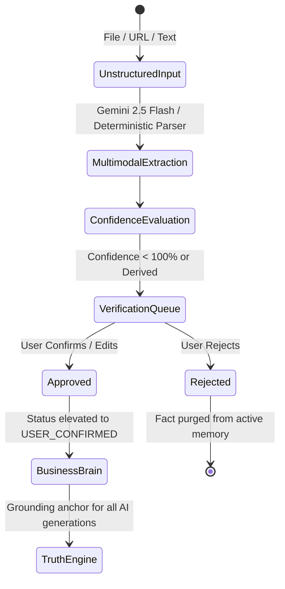
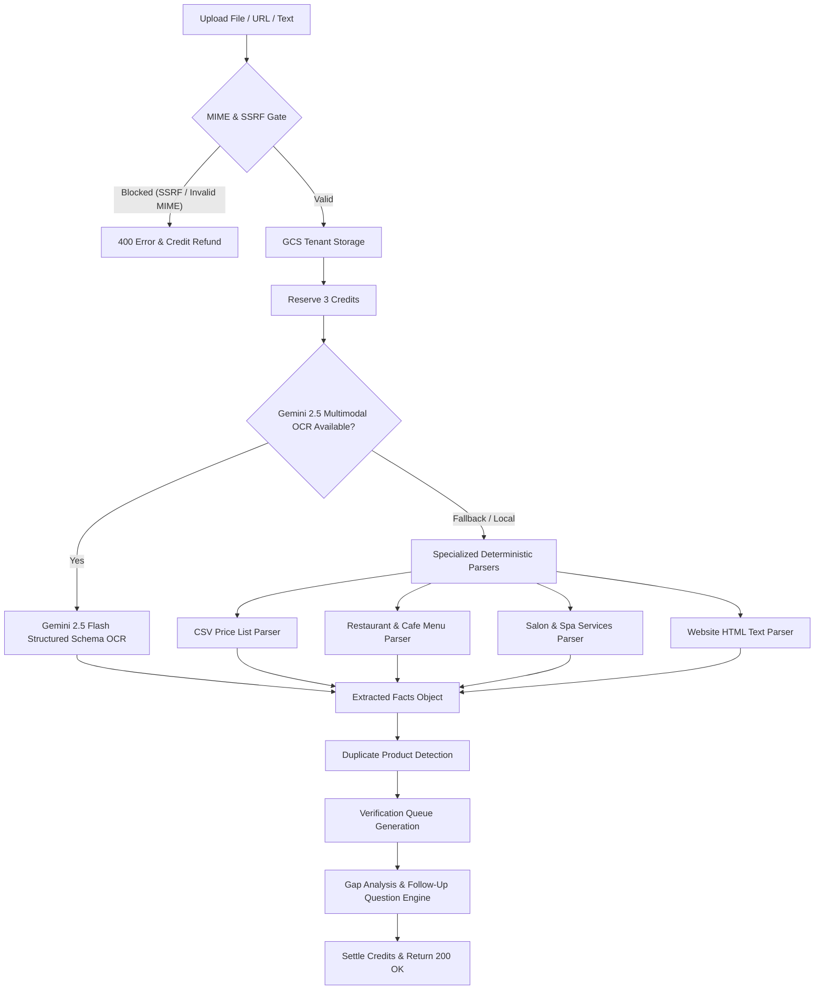

# BRAINWISE PHASE 1: BUSINESS KNOWLEDGE FOUNDATION
## Architecture & Data Model Specification

---

## 1. Executive Overview & System Purpose

The **BrainWise Business Brain** is the centralized, immutable single source of truth for the entire BrainWise platform. Every marketing strategy, social post, email campaign, brand asset, market positioning audit, and executive recommendation across all 14 BrainWise departments is grounded in this persistent knowledge base.

Phase 1 establishes the **Business Knowledge Foundation**, transforming unstructured business artifacts (menus, price lists, salon service catalogues, invoices, pitch decks, website URLs, and natural language prompts) into a strongly typed, tenant-isolated, query-efficient knowledge graph spanning 6 interconnected business domains.

```
+---------------------------------------------------------------------------------------------------+
|                                 BRAINWISE BUSINESS BRAIN (SINGLE SOURCE OF TRUTH)                  |
+---------------------------------------------------------------------------------------------------+
  |
  +---> Domain 1: Business Identity (Legal & display name, industry, model, stage, location, hours)
  |
  +---> Domain 2: Products & Services (SKUs, variants, prices, margins, features, benefits, FAQs)
  |
  +---> Domain 3: Customer Intelligence (Segments, pain points, motivations, objections, channels)
  |
  +---> Domain 4: Brand Intelligence (Visual identity, typography, palette, voice, claims, rules)
  |
  +---> Domain 5: Business Goals (Targets, metrics, revenue goals, timelines, milestones, status)
  |
  +---> Domain 6: Resources & Constraints (Budgets, staff, operational capacity, hard boundaries)
```

---

## 2. Core Architectural Principles & Guardrails

### 2.1 Fact Provenance Lifecycle
To eliminate hallucinations, every individual fact in the Business Brain carries an explicit `source` provenance tag:

| Provenance Level | Tag | Authority | Rules |
| :--- | :--- | :--- | :--- |
| **Founder Verified** | `USER_CONFIRMED` | **Authoritative (100%)** | Can NEVER be overwritten by AI inference. Highest precedence in prompt grounding. |
| **Document Extracted** | `DERIVED_FROM_DOC` | **High (80-95%)** | Extracted from uploaded business files. Routed to Verification Queue for user approval. |
| **AI Inferred** | `AI_INFERRED` | **Provisional (50-70%)** | Generated from industry benchmarks or heuristic gaps. Visually badged in amber until confirmed. |



### 2.2 Strict Video Exclusion Directives
Under the Master Project Rules:
- **Zero Video Infrastructure:** No FFmpeg pipelines, Remotion renderers, text-to-video APIs, or video-related credit meters exist.
- **Visual Collateral Boundaries:** Marketing outputs are strictly high-DPI print PDFs, vector SVGs (business cards, stationery, flyers, posters), and multi-frame static carousels.
- **Truth Check Enforcement:** Any LLM generation referencing video generation, reels, or video rendering triggers an immediate `EXCLUSION_BREACH` and credit safeguard release.

### 2.3 Financial & Operational Non-Hallucination
- BrainWise **never invents missing financial figures, turnover metrics, profit margins, or operational constraints**.
- Missing data is flagged as an active gap via `getMissingInformation()` and surfaced as structured follow-up questions to the founder.

---

## 3. The 6 Knowledge Domains

### Domain 1: Business Identity
- **Entity:** `BusinessProfileEntity`
- **Fields:**
  - `businessName`: Legal and trade name.
  - `tagline`: Public slogan or positioning phrase.
  - `industry` & `subIndustry`: Standardized NAICS/SIC taxonomy classifications.
  - `businessModel`: B2B, B2C, D2C, B2B2C, or Marketplace.
  - `stage`: `Idea / Pre-launch`, `Early Stage / MVP`, `Growing Business`, or `Established / Scaling`.
  - `location`: Primary headquarters address, city, region, and postal code.
  - `serviceAreas`: Array of targeted geographic zones or delivery radiuses.
  - `operationType`: `physical` (brick-and-mortar), `online` (e-commerce/digital), or `hybrid`.
  - `website`: Canonical company URL.
  - `operatingHours`: Formatted weekly schedule (e.g., `Mon-Fri 08:00-18:00 IST`).
  - `strengths` & `weaknesses`: Internal SWOT matrices.

### Domain 2: Products & Services
- **Entities:** `ProductEntity`, `ServiceEntity`
- **Fields:**
  - `productId` / `serviceId`: Unique UUID string.
  - `name`: Commercial title.
  - `sku`: Stock keeping unit identifier for inventory mapping.
  - `category` & `subcategory`: Hierarchical taxonomy.
  - `price` & `currency`: Numerical unit price and ISO 4217 code.
  - `pricingStructure`: `one-time`, `subscription`, `usage-based`, `tiered`, or `custom`.
  - `costOfGoods` & `marginEstimate`: COGS and profit margin percentage.
  - `features`: Array of functional capabilities.
  - `benefits`: Array of customer-facing value outcomes.
  - `targetCustomer`: Focused persona or demographic tier.
  - `duration`: Service execution length (e.g., `45 mins`).
  - `availability`: `in_stock`, `low_stock`, `out_of_stock`, or `discontinued`.
  - `isHeroProduct`: Boolean flag indicating flagship marketing focus.
  - `faqs`: Product-specific question-and-answer pairs.
  - `source`: Provenance tag (`USER_CONFIRMED` or `DERIVED_FROM_DOC`).

### Domain 3: Customer Intelligence
- **Entities:** `CustomerPersonaEntity`, `CustomerSegmentEntity`
- **Fields:**
  - `personaId` / `segmentId`: Unique identifier.
  - `name`: Persona title (e.g., "The Discerning Home Brewer").
  - `demographics`: Age brackets, income levels, geography, and education.
  - `needs`: Functional and emotional requirements.
  - `painPoints`: Frustrations with current market alternatives.
  - `buyingMotivations`: Core catalysts for purchase decisions.
  - `objections`: Reasons for hesitation or churn.
  - `preferredChannels`: Marketing touchpoints (Instagram, Google Search, LinkedIn, In-Store).
  - `isConfirmed`: Boolean provenance flag.

### Domain 4: Brand Intelligence
- **Entity:** `BrandIdentityEntity`
- **Fields:**
  - `brandName`: Canonical marketing brand.
  - `tagline`: Core brand proposition.
  - `mission` & `vision`: Guiding strategic statements.
  - `coreValues`: Array of organizational principles.
  - `voice`: 3-5 tone adjectives (e.g., `['Authoritative', 'Approachable', 'Artisanal']`).
  - `personality`: Personification descriptor.
  - `colorPalette`: Hex codes for `primary`, `secondary`, `accent`, `background`, and `neutral`.
  - `typography`: Font pairings for `headings`, `body`, and `accents`.
  - `preferredLanguage`: Standard localization language code (e.g., `en-IN`, `en-US`).
  - `wordsToUse`: Approved brand vocabulary.
  - `wordsToAvoid`: Forbidden terms or unapproved competitor vernacular.
  - `approvedClaims`: Legally and factually verified marketing assertions.
  - `restrictedClaims`: Forbidden promises (e.g., "Never state 100% organic without official estate certification").
  - `uniqueSellingProposition`: Deterministic differentiator.

### Domain 5: Business Goals
- **Entity:** `BusinessGoalEntity`
- **Fields:**
  - `goalId`: Unique identifier.
  - `title`: Executive objective.
  - `category`: `revenue`, `acquisition`, `retention`, `brand_awareness`, `market_expansion`, `product_launch`, or `operational_efficiency`.
  - `targetMetric`: Quantifiable KPI (e.g., `Monthly Recurring Revenue`, `New Accounts`).
  - `targetValue`: Numerical target.
  - `currentValue`: Current measured progress.
  - `unit`: Currency or count (`USD`, `Accounts`, `%`).
  - `timeframe`: `monthly`, `quarterly`, `annual`, or `custom`.
  - `deadline`: Target completion ISO date.
  - `status`: `on_track`, `at_risk`, `behind`, or `achieved`.

### Domain 6: Resources & Constraints
- **Sub-Object:** `BusinessResourcesAndConstraints` (embedded in `BusinessProfileEntity`)
- **Fields:**
  - `monthlyMarketingBudget`: Numeric monthly allowance in workspace currency.
  - `currency`: ISO currency code.
  - `teamCapabilities`: In-house skills (e.g., `Copywriting`, `Photography`, `Social Media`).
  - `operationalCapacity`: Output limits (e.g., `Maximum 50 custom kegs per week`).
  - `geographicBoundaries`: Operational or delivery confines.
  - `complianceRequirements`: Regulatory standards (e.g., FSSAI, FDA, GDPR, DPDPA).
  - `explicitExclusions`: Hard negative constraints (e.g., "Never claim instant coffee", "Never offer video generation").

---

## 4. Multi-Tenant Firestore Data Model

All business facts reside in strictly isolated collections partitioned by `workspaceId`:

```
workspaces/{workspaceId}
  |
  +---> businessProfile/current (Document: BusinessProfileEntity)
  |
  +---> products/{productId} (Collection: ProductEntity)
  |
  +---> services/{serviceId} (Collection: ServiceEntity)
  |
  +---> personas/{personaId} (Collection: CustomerPersonaEntity)
  |
  +---> documents/{documentId} (Collection: BusinessDocumentEntity)
  |
  +---> extractionJobs/{jobId} (Collection: ExtractionJobEntity)
  |
  +---> verificationQueue/{itemId} (Collection: VerificationItemEntity)
  |
  +---> brandIdentity/latest (Document: BrandIdentityEntity)
  |
  +---> businessGoals/{goalId} (Collection: BusinessGoalEntity)
  |
  +---> strategicMemory/current (Document: StrategicMemoryEntity)
  |
  +---> businessBrainVersions/{versionId} (Collection: BusinessBrainVersionEntity)
```

### 4.1 Schema Definitions

#### 4.1.1 `BusinessDocumentEntity`
```typescript
interface BusinessDocumentEntity {
  documentId: string;
  workspaceId: string;
  name: string;
  type: 'PDF' | 'IMAGE' | 'DOCX' | 'XLSX' | 'CSV' | 'TEXT' | 'URL';
  mimeType: string;
  storagePath: string;
  downloadUrl?: string;
  sizeBytes: number;
  uploadedBy: string;
  uploadedAt: string;
  status: 'PENDING' | 'PROCESSING' | 'COMPLETED' | 'FAILED';
  extractedData?: Record<string, unknown>;
  confidenceScore: number;
  errorMessage?: string;
}
```

#### 4.1.2 `ExtractionJobEntity`
```typescript
interface ExtractionJobEntity {
  jobId: string;
  workspaceId: string;
  documentId?: string;
  sourceType: 'file' | 'url' | 'text';
  sourceUrl?: string;
  status: 'queued' | 'processing' | 'completed' | 'failed';
  extractedData: {
    identity?: Partial<BusinessProfileEntity>;
    products?: Array<Partial<ProductEntity>>;
    services?: Array<Partial<ServiceEntity>>;
    audienceSegments?: Array<Partial<CustomerPersonaEntity>>;
    brand?: Partial<BrandProfileData>;
    goals?: Array<Partial<BusinessGoalEntity>>;
    resources?: Partial<BusinessResourcesAndConstraints>;
  };
  confidenceScore: number;
  verificationItemsCreated: number;
  duplicateProductsDetected: number;
  missingInformationPrompts: string[];
  creditsConsumed: number;
  createdAt: string;
  completedAt?: string;
}
```

#### 4.1.3 `VerificationItemEntity`
```typescript
interface VerificationItemEntity {
  itemId: string;
  workspaceId: string;
  jobId: string;
  domain: 'identity' | 'products' | 'services' | 'audience' | 'brand' | 'goals' | 'resources';
  fieldKey: string;
  fieldLabel: string;
  proposedValue: unknown;
  userEditedValue?: unknown;
  source: 'DERIVED_FROM_DOC' | 'AI_INFERRED';
  confidenceScore: number;
  status: 'pending' | 'approved' | 'rejected' | 'edited';
  verifiedBy?: string;
  verifiedAt?: string;
  createdAt: string;
}
```

#### 4.1.4 `BusinessBrainVersionEntity`
```typescript
interface BusinessBrainVersionEntity {
  versionId: string;
  workspaceId: string;
  versionNumber: number;
  changedBy: string;
  changeSummary: string;
  snapshot: BusinessProfileEntity;
  createdAt: string;
}
```

---

## 5. Multimodal Extraction Pipeline Architecture

The extraction pipeline ingests varied business collateral and normalizes it into verified domain facts.



### 5.1 Deduplication Algorithm
When new products or services are extracted or imported, `productRepository.importCatalogue()` executes a two-tiered check:
1. **SKU Matching:** Checks if an incoming SKU matches an existing record in `workspaces/{workspaceId}/products`.
2. **Normalized Name Matching:** Strips non-alphanumeric characters, normalizes case, and checks for identical commercial names.
3. **Collision Policy:**
   - Default: Flags product as duplicate, avoids creating duplicate records, and notifies user.
   - `updateExisting: true`: Merges updated price, description, and availability into the existing product document while preserving `USER_CONFIRMED` fact provenance.

---

## 6. Deterministic Truth Check & Anti-Fatigue Guardrails

### 6.1 Truth Check Engine (`src/utils/truthCheck.ts`)
Before any AI-generated marketing copy is delivered to the user:
1. **Price Grounding:** Extracts all numeric prices (`extractNumericPrices()`). If an ungrounded price is detected:
   - If truth score $\ge 50$, auto-remediates by replacing hallucinated price with the nearest verified catalogue price (`status: 'REMEDIATED'`).
   - If truth score $< 50$ (multiple critical violations), rejects generation (`status: 'REJECTED'`), blocks delivery, and triggers automated credit refund.
2. **Explicit Exclusions:** Scans for founder-defined forbidden claims (`strategicMemory.explicitExclusions` and `restrictedClaims`).
3. **Video Exclusion:** Enforces permanent exclusion of all video, reel, and video-editing claims.

### 6.2 Anti-Fatigue Engine (`src/server/services/businessBrainService.ts`)
- Every generated campaign angle is recorded via `recordStrategicAngle()`.
- If an angle or theme reaches the fatigue threshold ($\ge 3$ uses within a rolling window), the system generates anti-fatigue prompt directives forcing the LLM to pivot to fresh marketing angles.

---

## 7. Storage Architecture & Cloud Storage Paths

All files are stored in tenant-isolated Google Cloud Storage buckets under strict folder prefixes:

```
gs://{bucket_name}/workspaces/{workspaceId}/documents/{timestamp}-{sanitizedFilename}
```

- **MIME Whitelist:** `application/pdf`, `image/png`, `image/jpeg`, `image/webp`, `text/csv`, `application/vnd.openxmlformats-officedocument.spreadsheetml.sheet` (XLSX), `application/vnd.openxmlformats-officedocument.wordprocessingml.document` (DOCX), `text/plain`.
- **Pre-signed URLs:** Upload and download URLs are generated with short-lived (15-minute) cryptographic signatures enforcing `content-length-range` and matching `content-type`.
- **Tenant Validation:** Server-side middleware validates that `req.workspace.workspaceId` strictly matches the path prefix before issuing signed URLs or reading files.
