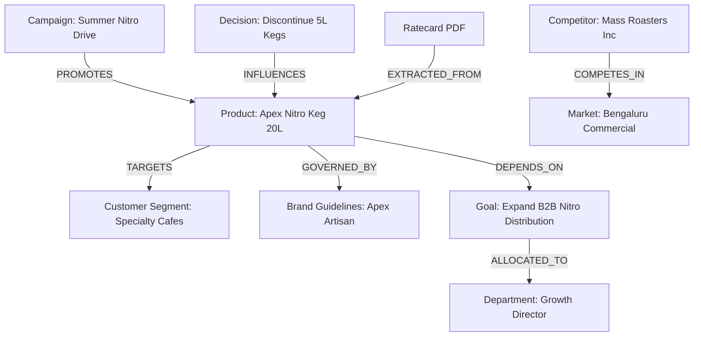

# BRAINWISE BUSINESS BRAIN — PHASE 2
## Deliverable 2.1: Knowledge Graph Architecture & Graph Data Model

---

### 1. Executive Overview & Purpose

In Phase 1, the BrainWise Business Brain established a normalized relational schema for verified facts: core identity, products, brand rules, competitor benchmarks, and financial parameters. However, complex SaaS enterprises operate on **interconnected dependencies**:
- A target audience is served by specific products with custom wholesale pricing.
- Marketing campaigns promote concrete SKUs and address specific customer segments.
- Operational boundaries constrain department goals.
- Strategic decisions supersede legacy practices based on performance experiments.

The **Business Knowledge Graph** transforms isolated business entities into an interconnected, multi-hop semantic graph. It enables any BrainWise department—from Growth Director to Financial Architect—to navigate relationships deterministically, eliminate duplicate data inputs, and ground AI responses in full contextual awareness.



---

### 2. Node Schema & Entity Hierarchy

Every node in the BrainWise Knowledge Graph is a strongly typed reference to either a core Business Brain record, a persistent artifact, or an organizational construct.

#### 2.1 Supported Graph Node Types (`GraphNodeType`)

| Node Type | Primary Domain Source | Description | Example Identifier |
| :--- | :--- | :--- | :--- |
| `business` | `workspaces/{wsId}/businessBrain/rootDoc` | Root workspace business identity | `biz_apex_artisan` |
| `product` | `workspaces/{wsId}/products/{prodId}` | Catalog product or physical SKU | `prod_keg_20l` |
| `service` | `workspaces/{wsId}/services/{srvId}` | Professional or subscription service | `srv_coffee_cupping` |
| `customer_persona` | `customerPersonas[]` | Target customer persona or ICP | `seg_specialty_cafes` |
| `customer_segment` | `customerSegments[]` | Market demographic / vertical | `seg_hospitality_chains` |
| `brand_guidelines` | `workspaces/{wsId}/brandIdentity/active` | Brand voice, tone, vocabulary rules | `bg_apex_primary` |
| `goal` | `primaryGoals[]` | Quarterly or annual operational target | `goal_arr_1m_2026` |
| `campaign` | `workspaces/{wsId}/campaigns/{campId}` | Multi-channel marketing campaign | `camp_summer_nitro_2026` |
| `competitor` | `workspaces/{wsId}/competitors/{compId}` | Tracked market rival | `comp_mass_roasters` |
| `market` | `industry` / `region` | Geographical or industry vertical | `mkt_bengaluru_b2b` |
| `document` | `workspaces/{wsId}/documents/{docId}` | Uploaded PDF, CSV, or doc artifact | `doc_wholesale_ratecard` |
| `decision` | `workspaces/{wsId}/memory/episodic/{epId}` | Strategic or operational founder choice | `dec_discontinue_5l` |
| `performance_result` | Analytics metrics / KPI snapshots | Measured outcome from campaign or pilot | `perf_nitro_q2_roas` |
| `department` | BrainWise System Enum (14 Depts) | Target agent or operational silo | `dept_growth_director` |

#### 2.2 Node Reference Interface (`GraphNodeRef`)

```typescript
export interface GraphNodeRef {
  id: string;                                   // Unique node identifier
  type: GraphNodeType;                          // Explicit node type
  name: string;                                 // Human-readable display label
  metadata?: Record<string, unknown>;           // Domain-specific attributes
}
```

---

### 3. Edge Schema & Relationship Taxonomy

Relationships between nodes are directed, labeled, timestamped, and stored under tenant-isolated subcollections.

#### 3.1 Edge Relationship Taxonomy (`GraphRelationshipType`)

| Relationship Type | Source Node Type | Target Node Type | Semantic Meaning |
| :--- | :--- | :--- | :--- |
| `BELONGS_TO` | Any | `business` / `department` | Ownership or structural hierarchy |
| `TARGETS` | `product` / `campaign` | `customer_persona` / `customer_segment` | Intended commercial or marketing audience |
| `PROMOTES` | `campaign` | `product` / `service` | Promotional focus of a marketing push |
| `GOVERNED_BY` | `campaign` / `product` | `brand_guidelines` | Copy and claims boundaries enforcement |
| `INFLUENCES` | `decision` / `performance_result`| `goal` / `product` / `campaign` | Strategic or causal feedback loop |
| `PRODUCES` | `campaign` / `service` | `performance_result` | Observable business or financial outcome |
| `INFORMS` | `document` / `competitor` | `decision` / `brand_guidelines` | Factual grounding for business choices |
| `COMPETES_IN` | `competitor` / `business` | `market` | Shared battleground or regional focus |
| `EXTRACTED_FROM` | `product` / `brand_guidelines`| `document` | Document extraction provenance link |
| `ALLOCATED_TO` | `goal` / `budget` | `department` | Responsibility and resource attribution |
| `DEPENDS_ON` | `product` / `campaign` | `goal` / `service` | Prerequisites and sequence constraints |
| `RESOLVES` | `decision` / `service` | `customer_persona` pain point | Problem-solution alignment |

#### 3.2 Knowledge Graph Edge Entity Interface

```typescript
export interface KnowledgeGraphEdgeEntity {
  edgeId: string;                               // Unique deterministic or UUID edge ID
  workspaceId: string;                          // Tenant isolation boundary
  source: GraphNodeRef;                         // Directed edge origin
  target: GraphNodeRef;                         // Directed edge destination
  relationshipType: GraphRelationshipType;      // Semantic verb
  weight?: number;                              // Optional confidence or priority weight (0.0 - 1.0)
  properties?: Record<string, unknown>;         // Contextual attributes (discounts, channels, etc.)
  createdAt: string;                            // ISO 8601 creation timestamp
  updatedAt: string;                            // ISO 8601 update timestamp
}
```

---

### 4. Firestore Physical Storage & Indexing Strategy

#### 4.1 Document Path Architecture
All graph edges are strictly contained within the workspace root to preserve complete multi-tenant security:
```
workspaces/{workspaceId}/knowledgeGraphEdges/{edgeId}
```

#### 4.2 Composite Indexes Required
To support sub-millisecond graph queries and traversal, the following composite indexes are configured:
1. `(workspaceId ASC, source.id ASC, relationshipType ASC)` — Rapid outgoing edge lookup.
2. `(workspaceId ASC, target.id ASC, relationshipType ASC)` — Rapid incoming edge lookup.
3. `(workspaceId ASC, relationshipType ASC, createdAt DESC)` — Relationship filtering across workspace.

#### 4.3 Deterministic Edge Identification
Edge IDs can be generated deterministically to guarantee idempotency and avoid duplicate parallel relationships:
$$\text{edgeId} = \text{hash}(\text{source.id} + \text{"\_"} + \text{relationshipType} + \text{"\_"} + \text{target.id})$$
If an identical edge is submitted with revised `properties`, it performs an atomic merge update without duplicating graph paths.

---

### 5. Graph Traversal Algorithms & Multi-Hop Expansion

The graph engine supports forward, reverse, and bidirectional multi-hop traversal with cycle prevention.

#### 5.1 Traversal Algorithm Specification

```typescript
async traverse(workspaceId: string, startNodeId: string, maxDepth: number = 2): Promise<{
  nodes: GraphNodeRef[];
  edges: KnowledgeGraphEdgeEntity[];
}>
```

1. **Queue Initialization:** Initialize a FIFO exploration queue with `(nodeId = startNodeId, depth = 0)`.
2. **Cycle Prevention:** Maintain a `visitedNodes: Set<string>` and `visitedEdges: Set<string>`.
3. **Breadth-First Exploration (BFS):**
   - Pop next node. If `depth >= maxDepth`, continue.
   - Execute parallel indexed queries:
     - `db.collection('knowledgeGraphEdges').where('source.id', '==', currentNodeId)`
     - `db.collection('knowledgeGraphEdges').where('target.id', '==', currentNodeId)`
   - Collect unique adjacent nodes and untraversed edges.
   - Enqueue unvisited neighbors at `depth + 1`.
4. **Depth Termination:** Exploration stops strictly at `maxDepth` (default: 2 hops, capped at 3 hops) to enforce sub-10ms response budgets.

#### 5.2 Real-World Traversal Scenario: Two-Hop Campaign Context
```
[Campaign: Summer Nitro Cafe Drive]
        │
   (PROMOTES)
        ▼
[Product: Apex Nitro Keg 20L]
        │
   (TARGETS)
        ▼
[Customer Segment: Independent Specialty Cafes]
```
When the Growth Director drafts marketing collateral for `Summer Nitro Cafe Drive`, the traversal engine discovers in 2 hops that the product targets *Independent Specialty Cafes*, automatically fetching wholesale discount tiers (15%) without querying the user.

---

### 6. Security & Multi-Tenancy Guardrails

1. **Workspace Scoping:** All graph repository functions (`findOutgoingEdges`, `findIncomingEdges`, `traverse`) require `workspaceId` as the leading parameter.
2. **Authorization Middleware:** `requireWorkspaceMember` inspects caller session headers against `workspaces/{workspaceId}/members/{userId}` before graph endpoints execute.
3. **Cross-Tenant Zero Leakage:** In Scenario 10, cross-tenant graph traversal attempts return `403 FORBIDDEN` immediately, and internal service queries strictly filter by tenant ID.
