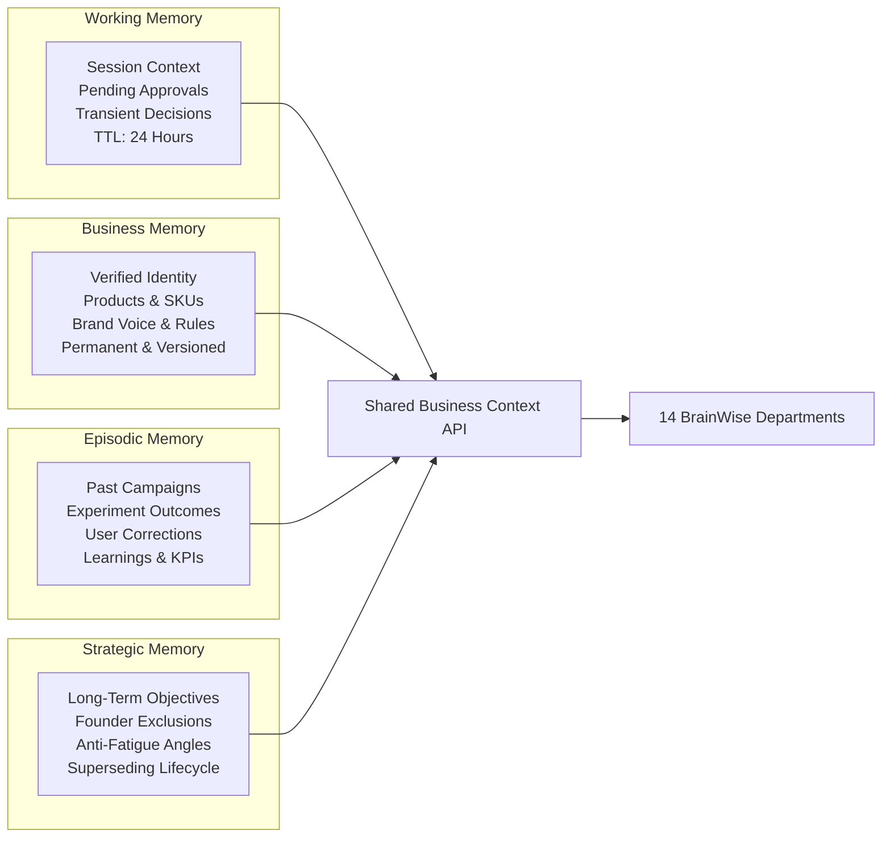

# BRAINWISE BUSINESS BRAIN — PHASE 2
## Deliverable 2.2: Memory Systems Architecture (4 Distinct Tiers)

---

### 1. Architectural Mission & The Four-Memory Paradigm

Traditional AI assistants suffer from "context amnesia" between turns and "static rigidity" across business evolutions. An enterprise SaaS copilot must distinguish between:
1. What the user is currently working on in this active session (short-term state).
2. Permanent verified facts about the company (authoritative single source of truth).
3. Past experiences, experiments, decisions, and campaign learnings (experiential context).
4. Long-term strategic north stars and founder guardrails (anti-fatigue directives).

BrainWise implements **Four Discrete Memory Systems** operating simultaneously across all 14 departments:



---

### 2. Tier 1: Working Memory (Short-Term & Transient)

#### 2.1 Scope & Purpose
Working Memory tracks active user intent within a specific session. When a founder chats with the Growth Director, drafts collateral, or runs scenario models, Working Memory maintains:
- Active task and step name.
- Temporary decisions made mid-workflow before final approval.
- Pending human approvals (Category C write actions).
- Recent conversation turns for immediate conversational coherence.

#### 2.2 Data Model & Interface (`WorkingMemoryEntity`)

```typescript
export interface WorkingMemoryEntity {
  sessionId: string;                            // Unique session or conversation UUID
  workspaceId: string;                          // Tenant isolation
  userId: string;                               // Acting operator
  currentTask?: string;                         // e.g. "Drafting Q3 Wholesale Partnership Deck"
  activeWorkflow?: string;                      // e.g. "brand_collateral"
  temporaryDecisions?: Array<{                  // Uncommitted choices
    id: string;
    decision: string;
    createdAt: string;
  }>;
  pendingApprovals?: Array<{                    // Actions awaiting founder sign-off
    actionId: string;
    description: string;
    riskTier: 'A' | 'B' | 'C';
    createdAt: string;
  }>;
  conversationTurns?: Array<{                   // Rolling conversational buffer (last 10 turns)
    role: 'user' | 'assistant' | 'system';
    content: string;
    timestamp: string;
  }>;
  ttlSeconds: number;                           // Time-To-Live in seconds (default: 86400 / 24h)
  createdAt: string;
  updatedAt: string;
  expiresAt: string;                            // ISO 8601 absolute expiration timestamp
}
```

#### 2.3 Storage Path & TTL Pruning Lifecycle
- **Firestore Path:** `workspaces/{workspaceId}/workingMemory/{sessionId}`
- **Expiration Check:** On every `getWorkingContext()` call, the repository evaluates:
  $$\text{isExpired} = \text{new Date}() > \text{new Date}(\text{entity.expiresAt})$$
  If expired, the document is deleted asynchronously and `null` is returned immediately.
- **Auto-Pruning Daemon:** `pruneExpiredWorkingMemory(workspaceId)` queries `where('expiresAt', '<', now)` to clean inactive sessions.

---

### 3. Tier 2: Business Memory (Permanent & Authoritative)

#### 3.1 Scope & Purpose
Business Memory stores the core facts of the enterprise. This data is **permanent**, version-controlled, and changes only via explicit user action or verified document extraction. It forms the foundation for the BrainWise Truth Engine.

#### 3.2 Key Pillars of Business Memory
1. **Core Identity:** Legal name, brand name, tagline, stage, location, industry, operating model, hours.
2. **Product & Service Catalog:** Verified SKUs, unit prices, cost of goods, margins, features, benefits.
3. **Brand Intelligence:** Tone, voice descriptors, mandatory vocabulary, forbidden words, approved claims, restricted claims, unique selling proposition.
4. **Operational Parameters:** Monthly marketing budget, weekly production throughput, fulfillment times.

#### 3.3 Storage Path & Version Control
- **Current Active Root:** `workspaces/{workspaceId}/businessBrain/rootDoc`
- **Immutable Version History:** `workspaces/{workspaceId}/businessBrainHistory/v{versionNumber}`
- Every mutation increments the version counter, stamps `lastUpdated`, records the modifying `userId`, and creates a full snapshot in history.

---

### 4. Tier 3: Episodic Memory (Experiential & Historical)

#### 4.1 Scope & Purpose
Episodic Memory captures **what happened**, what succeeded, what failed, and what was learned over time. When an AI agent suggests a marketing direction, Episodic Memory prevents repeating past failures and leverages proven winners.

#### 4.2 Data Model & Interface (`EpisodicMemoryEntity`)

```typescript
export interface EpisodicMemoryEntity {
  episodeId: string;                            // Unique episode identifier
  workspaceId: string;                          // Tenant boundary
  department: string;                           // Originating department (e.g. "GROWTH_DIRECTOR")
  activityType:                                 // Event category
    | 'campaign_launch'
    | 'strategic_decision'
    | 'user_correction'
    | 'experiment_result'
    | 'customer_feedback';
  title: string;                                // Concise summary label
  summary: string;                              // Comprehensive narrative description
  learnings: string[];                          // Extracted bullet-point insights
  outcomes?: Record<string, unknown>;           // Measured KPIs (e.g. { marginImprovement: "+18%" })
  relatedNodeIds?: string[];                    // Graph references (campaigns, products, personas)
  createdAt: string;                            // ISO 8601 timestamp
}
```

#### 4.3 Storage Path & Query Semantics
- **Firestore Path:** `workspaces/{workspaceId}/memory/episodic/{episodeId}`
- **Query Patterns:**
  - `listEpisodes(workspaceId, { department: 'GROWTH_DIRECTOR', limit: 5 })`
  - Hybrid search retrieval matches queries like *"why did we stop 5L kegs"* to retrieve learnings and prevent repeating discontinued packaging.

---

### 5. Tier 4: Strategic Memory (North Stars & Anti-Fatigue)

#### 5.1 Scope & Purpose
Strategic Memory steers the trajectory of the business and protects brand novelty:
- Long-term strategic priorities (e.g., "Third-Party Cold Chain Logistics expansion").
- Non-negotiable founder exclusions (e.g., "Never claim instant coffee", "Never offer video generation").
- Strategic angles and marketing themes tracked against audience fatigue thresholds.

#### 5.2 Data Model & Interface (`StrategicMemoryItemEntity`)

```typescript
export interface StrategicMemoryItemEntity {
  itemId: string;                               // Unique identifier
  workspaceId: string;                          // Tenant boundary
  type:                                         // Strategic category
    | 'long_term_objective'
    | 'strategic_priority'
    | 'positioning_shift'
    | 'founder_exclusion';
  title: string;                                // Strategic mandate headline
  description: string;                          // Rationale and operational guidelines
  status: 'active' | 'superseded' | 'archived'; // Lifecycle status
  supersededBy?: string;                        // Pointer to replacing itemId
  supersedesId?: string;                        // Pointer to prior itemId
  targetDate?: string;                          // Milestone target
  createdAt: string;
  updatedAt: string;
}
```

#### 5.3 The Superseding Lifecycle Protocol
Business strategy evolves. To maintain historical auditability without poisoning current context:
1. When a founder shifts strategy from *Bootstrapped Regional Distribution* to *Third-Party Cold Chain Logistics*:
2. `memoryService.supersedeStrategicItem(workspaceId, oldItemId, newPayload)` executes an atomic update:
   - Sets `oldItem.status = 'superseded'` and `oldItem.supersededBy = newItem.itemId`.
   - Inserts `newItem` with `status = 'active'` and `supersedesId = oldItemId`.
3. The Shared Context API strictly filters `status == 'active'`, ensuring downstream AI agents immediately follow the new logistics strategy while preserving complete historical provenance.

#### 5.4 Anti-Fatigue Engine & Strategic Angles
- `recordStrategicAngle(workspaceId, angleKey, context)` tracks theme frequency across all generated copy.
- When an angle exceeds fatigue frequency (default: 3 occurrences in 30 days), the Anti-Fatigue Guardrail injects a negative directive into LLM system prompts, forcing creative diversity.

---

### 6. Memory Tier Summary Matrix

| Memory Tier | Permanence | Latency | Invalidation Trigger | Primary Consumer |
| :--- | :--- | :--- | :--- | :--- |
| **Working Memory** | 24 Hours (TTL) | < 1ms | Expiration, task completion, session close | Strategist Drawer, Active Editors |
| **Business Memory** | Permanent | < 1ms | Founder edit, verified doc ingestion | All 14 Departments, Truth Engine |
| **Episodic Memory** | Multi-Year | ~2ms | Never (append-only ledger) | Planning Agents, Post-Mortems |
| **Strategic Memory** | Multi-Quarter | < 1ms | Superseding workflow, OKR review | Growth Director, Idea Intelligence |
