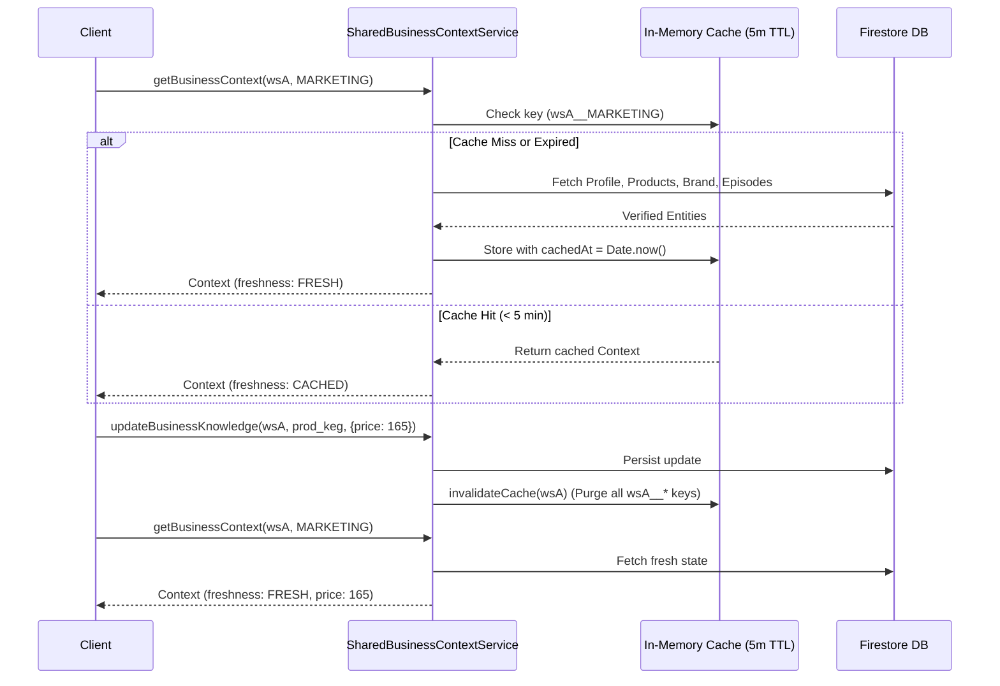

# BRAINWISE BUSINESS BRAIN — PHASE 2
## Deliverable 2.4: Shared Business Context API & Memory Service Contracts

---

### 1. Architectural Role & Objective

The **Shared Business Context API** provides the unified access layer through which all 14 BrainWise departments, UI components, background jobs, and AI agents interact with the Business Brain. It enforces:
1. **Context Deduplication:** Downstream agents do not make separate queries for products, brand rules, and constraints; a single call provides a synthesized, typed context envelope.
2. **Sub-Millisecond Caching with Immediate Invalidation:** Cached reads return in under 1ms; any write or update to business facts immediately clears the cache for that tenant.
3. **Multi-Tenant Security Isolation:** Every endpoint enforces strict session token and workspace membership checks.

---

### 2. Primary Endpoints Specification

#### 2.1 Get Assembled Business Context
Returns a unified, token-budgeted business context envelope tailored to the calling task.

- **Endpoint:** `GET /api/v1/workspaces/:workspaceId/business-profile/context`
- **Headers:** `Authorization: Bearer <token>`
- **Query Parameters:**
  - `taskType` (string, optional): Target department task (e.g., `MARKETING`, `FINANCIAL`, `STRATEGY`). Default: `GENERAL`.
  - `sessionId` (string, optional): Active session ID to attach working memory snapshots.
  - `bypassCache` (boolean, optional): If `true`, re-evaluates database directly.

**Response Structure (`200 OK`):**
```json
{
  "status": "success",
  "data": {
    "workspaceId": "ws_apex_01",
    "taskType": "MARKETING",
    "businessSummary": "Apex Artisan Roasters (Growing Business). Single-origin farm traceable nitro kegs for cafes",
    "relevantProducts": [
      {
        "id": "prod_keg_20l",
        "name": "Apex Nitro Keg 20L",
        "category": "Commercial Kegs",
        "price": 165,
        "currency": "USD",
        "pricingStructure": "one-time",
        "features": ["48-hr cold extraction", "Nitrogen pressurized"],
        "benefits": ["Silky foam head", "Zero prep labor"]
      }
    ],
    "relevantAudiences": [
      {
        "personaName": "Independent Specialty Cafe Owner",
        "painPoints": ["Inconsistent cold brew", "Prep labor"]
      }
    ],
    "brandDirectives": {
      "voice": ["Authoritative", "Artisanal", "Direct"],
      "wordsToUse": ["Single-origin", "Craft-roasted", "Nitro draft"],
      "wordsToAvoid": ["Instant", "Cheap"],
      "approvedClaims": ["Roasted within 48 hours of shipment"],
      "restrictedClaims": ["Never claim organic without official estate certification"]
    },
    "activeGoals": [
      { "title": "Onboard 50 commercial cafe keg accounts in Q3" }
    ],
    "relevantConstraints": [
      "Marketing Budget: $5000 / month",
      "Capacity Limit: 100 kegs / week",
      "Rule: Never claim instant coffee",
      "Rule: Never offer video generation"
    ],
    "recentEpisodes": [
      {
        "title": "Discontinue 5L Mini-Kegs",
        "summary": "5L consumer mini-kegs yielded insufficient margins.",
        "learnings": ["Focus exclusively on 20L commercial kegs"]
      }
    ],
    "workingMemorySnapshot": {
      "currentTask": "Drafting Q3 Wholesale Partnership Deck"
    },
    "citations": [
      {
        "sourceId": "src_profile_ws_apex_01",
        "sourceType": "USER_CONFIRMED_FACT",
        "title": "Apex Artisan Roasters Profile",
        "confidence": 1.0,
        "verifiedAt": "2026-11-20T08:00:00Z"
      }
    ],
    "freshness": "CACHED",
    "cachedAt": "2026-11-20T08:15:00Z"
  }
}
```

---

#### 2.2 Hybrid Knowledge Search
Performs multi-channel search combining structured facts, keyword BM25, document chunks, and graph edges.

- **Endpoint:** `POST /api/v1/workspaces/:workspaceId/business-profile/knowledge/search`
- **Request Body:**
```json
{
  "query": "wholesale ratecard minimum order",
  "taskType": "MARKETING",
  "filters": {
    "verificationStatus": "VERIFIED",
    "entityTypes": ["product", "document"]
  },
  "tokenBudget": 2000,
  "maxResults": 10
}
```
- **Response Structure (`200 OK`):**
```json
{
  "status": "success",
  "data": {
    "items": [
      {
        "id": "doc_wholesale_ratecard",
        "type": "document",
        "title": "Apex_Wholesale_Ratecard_2026.pdf",
        "content": "Official wholesale pricing tier for commercial cafes. Minimum order 2 kegs.",
        "relevanceScore": 0.88,
        "combinedScore": 0.92,
        "freshnessScore": 1.0,
        "verificationStatus": "VERIFIED",
        "sourceCitation": {
          "sourceId": "doc_wholesale_ratecard",
          "sourceType": "DOCUMENT",
          "title": "Apex_Wholesale_Ratecard_2026.pdf",
          "confidence": 0.94
        }
      }
    ],
    "citations": [...],
    "totalResults": 1,
    "tokenCount": 18,
    "tokenBudget": 2000
  }
}
```

---

#### 2.3 Knowledge Graph Management & Traversal

##### A. List Edges
`GET /api/v1/workspaces/:workspaceId/business-profile/graph/edges?nodeId=prod_keg_20l&relationshipType=TARGETS`

##### B. Create Edge
`POST /api/v1/workspaces/:workspaceId/business-profile/graph/edges`
```json
{
  "source": { "id": "prod_keg_20l", "type": "product", "name": "Apex Nitro Keg 20L" },
  "target": { "id": "seg_specialty_cafes", "type": "customer_segment", "name": "Independent Specialty Cafes" },
  "relationshipType": "TARGETS",
  "properties": { "wholesaleDiscount": "15%" }
}
```

##### C. Graph Traversal
`GET /api/v1/workspaces/:workspaceId/business-profile/graph/traverse?startNodeId=camp_summer_nitro_2026&maxDepth=2`
Returns `{ nodes: GraphNodeRef[], edges: KnowledgeGraphEdgeEntity[] }` discovered across BFS hops.

##### D. Delete Edge
`DELETE /api/v1/workspaces/:workspaceId/business-profile/graph/edges/:edgeId`

---

#### 2.4 Memory Tier Endpoints

##### A. Working Memory
- `GET /api/v1/workspaces/:workspaceId/business-profile/memory/working?sessionId=sess_123`
- `POST /api/v1/workspaces/:workspaceId/business-profile/memory/working`
```json
{
  "sessionId": "sess_123",
  "currentTask": "Drafting Q3 Wholesale Partnership Deck",
  "activeWorkflow": "brand_collateral",
  "temporaryDecisions": [{ "decision": "Use 20L keg as hero image" }],
  "ttlSeconds": 86400
}
```

##### B. Episodic Memory
- `GET /api/v1/workspaces/:workspaceId/business-profile/memory/episodic?department=GROWTH_DIRECTOR`
- `POST /api/v1/workspaces/:workspaceId/business-profile/memory/episodic`
```json
{
  "department": "GROWTH_DIRECTOR",
  "activityType": "strategic_decision",
  "title": "Discontinue 5L Mini-Kegs",
  "summary": "5L consumer mini-kegs yielded insufficient margins and high packaging return cost.",
  "learnings": ["Focus exclusively on 20L commercial kegs for B2B accounts"],
  "outcomes": { "marginImprovement": "+18%" }
}
```

##### C. Strategic Memory & Superseding
- `GET /api/v1/workspaces/:workspaceId/business-profile/memory/strategic?status=active`
- `POST /api/v1/workspaces/:workspaceId/business-profile/memory/strategic`
- `POST /api/v1/workspaces/:workspaceId/business-profile/memory/strategic/:itemId/supersede`
```json
{
  "type": "strategic_priority",
  "title": "Third-Party Cold Chain Logistics",
  "description": "Contract with temperature-controlled 3PL to expand state-wide distribution."
}
```

---

### 3. Caching & Invalidation Architecture



---

### 4. Frontend Client SDK Integration (`apiClient.ts`)

Typed client helper methods are integrated directly into `BrainWiseApiClient`:

```typescript
// Fetch unified business context
const context = await apiClient.getBusinessContext(workspaceId, { taskType: 'MARKETING' });

// Perform hybrid knowledge search
const searchResults = await apiClient.searchKnowledge(workspaceId, {
  query: 'nitro keg price',
  filters: { verificationStatus: 'VERIFIED' }
});

// Create relationship edge
await apiClient.createGraphEdge(workspaceId, {
  source: { id: 'prod_keg_20l', type: 'product', name: 'Apex Nitro Keg 20L' },
  target: { id: 'seg_specialty_cafes', type: 'customer_segment', name: 'Specialty Cafes' },
  relationshipType: 'TARGETS'
});

// Read and update working memory
await apiClient.setWorkingMemory(workspaceId, {
  sessionId,
  currentTask: 'Drafting presentation'
});
```
