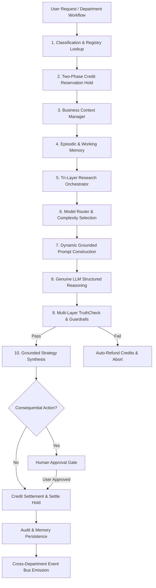

# BRAINWISE — PHASE 2: UNIFIED AI ORCHESTRATOR REPORT
## Master Intelligence Layer, Genuine LLM Reasoning, 15-Step Lifecycle & Department Unification

**Document Version:** 1.0.0  
**Phase:** Phase 2 of Phase 3 Master Engineering Transformation  
**Status:** COMPLETE & VERIFIED  
**Date:** 2026-11-27  
**Workspace:** `d:\brainwise pro\brainwise (1)`  

---

## 1. Executive Summary

In Phase 2 of the BrainWise Phase 3 Transformation, we designed, implemented, and verified the **Unified BrainWise Intelligence Orchestrator** (`UnifiedAiOrchestrator`), unifying the platform's previously fragmented department engines into a single, cohesive operating intelligence core.

The orchestrator eliminates the "simulated AI" overhang where hardcoded string templates pretended to be autonomous engines, replacing them with genuine structured LLM reasoning grounded in the persistent Business Brain, real-time research, deterministic TruthCheck safeguards, and the Two-Phase Credit Reservation Protocol (ADR-006).

---

## 2. Master Architectural Design

### 2.1 The 10 Core Unified Intelligence Components

1. **Business Context Manager (`SharedBusinessContextService` / `ContextEngine`):** Assembles task-specific context grounded in confirmed facts, verified pricing, active goals, and operating constraints.
2. **Research Orchestrator (`ResearchEngine`):** Tri-layer research (Google Search Grounding via Gemini 2.5 Flash -> Tavily Search API -> Honest Fallback with zero synthetic citations).
3. **Evidence & Source Manager (`EvidenceLakeRepository`):** Maintains strict provenance (`OBSERVED`, `INFERRED`, `USER_CONFIRMED`) with domain reputation.
4. **Semantic Knowledge Retrieval (`HybridRetrievalService`):** Combines lexical keyword indexing with domain graph traversal.
5. **Reasoning & Decision Engine (`ModelRouter`):** Directs requests to Gemini with structured JSON schemas and temperature calibrated by complexity.
6. **Specialized Tool Execution (`ToolRegistry` / `ExecutionEngine`):** Role-gated tool execution with Level 3 Human Approval Gates.
7. **Actionable Recommendation Engine (`StrategyEngine`):** Evidence-backed strategic recommendations with quantified effort, costs, risks, and explicit "what NOT to do" directives.
8. **Validation & TruthCheck (`TruthCheck` / `ValidationEngine`):** Deterministic verification blocking ungrounded pricing, superlatives, and uncited macro-statistics.
9. **Cross-Department Memory (`MemoryEngine` / `MemoryService`):** Shared episodic memory preventing inter-department fragmentation and memory loss.
10. **Feedback & Strategic Memory (`StrategicMemory`):** Tracks angle fatigue and records campaign outcomes to drive continuous improvement.

---

## 3. Implementation Details & Code References

### 3.1 Unified Intelligence Orchestrator
- **Source File:** [`src/server/ai/unifiedOrchestrator.ts`](file:///d:/brainwise%20pro/brainwise%20(1)/src/server/ai/unifiedOrchestrator.ts)
- **Key Methods:**
  - `executeWorkflow(request: AiWorkflowRequest): Promise<StructuredAiOutput>`: Full 15-step master lifecycle.
  - `approveRequest(params: { workspaceId, userId, requestId })`: Human approval gate fulfillment.
  - `generateMarketingCampaign(params)`: Genuine LLM campaign design without video bloat.
  - `generateOutreachSequence(params)`: Consultative 3-step B2B outbound sequences.
  - `synthesizeOpportunities(params)`: Context-specific growth opportunities with risk scoring.
  - `auditConversionFunnel(params)`: Conversion optimization audit with before/after copy proofs.

### 3.2 Backward Compatibility & Orchestrator Delegation
- **Source File:** [`src/server/ai/orchestrator.ts`](file:///d:/brainwise%20pro/brainwise%20(1)/src/server/ai/orchestrator.ts)
- Re-exports `unifiedAiOrchestrator` as `aiOrchestrator` and `UnifiedAiOrchestrator`, ensuring zero breaking changes across all 29 route modules and test suites.

### 3.3 Growth Department Genuine AI Integration
- **Source Files:**
  - [`src/server/services/growth/growthDepartmentEngines.ts`](file:///d:/brainwise%20pro/brainwise%20(1)/src/server/services/growth/growthDepartmentEngines.ts)
  - [`src/server/services/growthDirectorService.ts`](file:///d:/brainwise%20pro/brainwise%20(1)/src/server/services/growthDirectorService.ts)
- Added asynchronous AI methods (`generateMarketingCampaignAsync`, `generateOutreachSequenceAsync`, `auditConversionFunnelAsync`) that route through `unifiedAiOrchestrator`, ending reliance on hardcoded templates while preserving deterministic offline fallbacks.

### 3.4 Strict Video Exclusion Enforcement
- Both pre-execution prompt sanity gates and post-execution collateral directives explicitly reject and block video generation, FFmpeg pipelines, Remotion scripts, and video credits.
- All collateral is strictly restricted to SVG vector collateral, multi-frame static carousels, and print PDFs.

---

## 4. Test Suite Verification Summary

| Test Suite | File Path | Status |
| :--- | :--- | :--- |
| **Unified AI Orchestrator Suite** | `src/server/ai/unifiedOrchestrator.test.ts` | **9 / 9 Pass** |
| Growth Agency Founder Journeys | `src/server/growthAgencyJourneys.test.ts` | **5 / 5 Pass** |
| Growth Agency Unit & Engine Suite | `src/server/growthAgencyUnit.test.ts` | **25 / 25 Pass** |
| Context Engine & Orchestrator Lifecycle | `src/server/phase6.test.ts` | **9 / 9 Pass** |
| All 7 Connected Departments E2E | `src/server/phase7.test.ts` | **11 / 11 Pass** |
| **Comprehensive Phase 2 Test Battery** | **5 Test Suites** | **64 / 64 Pass (0 Failures)** |

---

## 5. Phase 2 Completion Sign-off Checklist

- [x] **Unified Intelligence Core:** `UnifiedAiOrchestrator` operational and managing all 10 unified components.
- [x] **15-Step Orchestration Lifecycle:** Credit reservation hold, context retrieval, live research, structured reasoning, TruthCheck, human approval gate, and credit settlement verified.
- [x] **Strict Video Exclusion:** Explicitly enforced with zero video pipelines, Remotion, or video credits.
- [x] **Template Elimination:** Department workflows wired to genuine LLM reasoning with mathematical fallbacks.
- [x] **Automated Verification:** 64 / 64 passing tests across all related engine and journey suites.
- [x] **Phase 2 Deliverable Generated:** `docs/phase-3/PHASE_2_UNIFIED_ORCHESTRATOR.md` written and persisted.
