# BRAINWISE — SERVICE DEPENDENCY MAP & DATA FLOW ARCHITECTURE
**Document:** `docs/phase-3/SERVICE_DEPENDENCY_MAP.md`  
**Date:** November 27, 2026  
**Auditor:** Principal AI Architect & Systems Engineer  
**Status:** COMPLETE & VERIFIED  

---

## 1. Top-Level Service Dependency Graph

The diagram below traces how requests move from API routes through orchestration, context management, AI providers, and persistence layers:

```mermaid
flowchart TD
    Client[Client / Frontend / Postman] --> Routes[API Route Handlers: src/server/routes/v1/*]
    
    subgraph AuthAndTenant ["Authorization & Tenancy Layer"]
        Routes --> AuthMW[auth.ts / devAuthBypass.ts]
        AuthMW --> WorkspaceAuth[validateWorkspaceAccess]
    end

    subgraph OrchestrationLayer ["Orchestration & Workflow Coordination"]
        WorkspaceAuth --> AIOrch[aiOrchestrationService.ts]
        WorkspaceAuth --> CoreOrch[orchestrator.ts: AiOrchestrator]
        WorkspaceAuth --> DeptCoord[departmentCoordinationService.ts]
        WorkspaceAuth --> GrowthDir[growthDirectorService.ts]
    end

    subgraph ContextAndMemory ["Context & Memory Subsystems"]
        CoreOrch --> ContextEngine[contextEngine.ts]
        CoreOrch --> MemoryEngine[memoryEngine.ts]
        AIOrch --> SharedContext[sharedBusinessContextService.ts]
        SharedContext --> HybridRetrieval[hybridRetrievalService.ts]
        SharedContext --> KnowledgeGraph[knowledgeGraphService.ts]
    end

    subgraph DataRepositories ["Data Access Layer (Firestore / Memory DB)"]
        ContextEngine --> BizProfileRepo[businessProfileRepository.ts]
        ContextEngine --> ProductRepo[productRepository.ts]
        ContextEngine --> BrandRepo[brandIdentityRepository.ts]
        MemoryEngine --> MemoryRepo[memoryRepository.ts]
        SharedContext --> GoalRepo[goalRepository.ts]
        SharedContext --> CompRepo[competitorRepository.ts]
        DeptCoord --> DeptTaskRepo[departmentTaskRepository.ts]
    end

    subgraph ExecutionAndAI ["AI Providers & External Tools"]
        CoreOrch --> ModelRouter[modelRouter.ts: ModelRouter]
        ModelRouter --> GeminiAdapter[GeminiProviderAdapter: Google GenAI SDK]
        CoreOrch --> ResearchEngine[researchEngine.ts: ResearchEngine]
        ResearchEngine --> TavilyAPI[Tavily Search API / SERP]
        ResearchEngine --> EvidenceLakeRepo[evidenceLakeRepository.ts]
    end

    subgraph GuardrailsAndFinance ["Invariable Guardrails & Settlement"]
        CoreOrch --> CreditSvc[creditService.ts: Two-Phase Reservation]
        CoreOrch --> ValidationEngine[validationEngine.ts]
        ValidationEngine --> TruthCheck[truthCheck.ts: Regex Guardrails]
        CoreOrch --> StrategicMemory[strategicMemory.ts: Anti-Fatigue]
        DeptCoord --> DeptEventBus[eventBus.ts: DepartmentEventBus]
    end

    CreditSvc --> WalletRepo[creditWalletRepository.ts]
    CreditSvc --> TxRepo[transactionRepository.ts]
```

---

## 2. Key Execution Pipelines & Inter-Service Dependencies

### 2.1 The Market Dossier Pipeline (`FEAT-RES-001`, 8 Credits)
1. **Entrypoint:** `POST /api/v1/research/orchestrate` or `POST /api/v1/ai/dossier`
2. **Execution Flow:**
   - `aiRoutes.ts` calls `aiOrchestrationService.generateDossier()`.
   - `aiOrchestrationService` invokes `creditService.reserveCredits({ featureId: 'FEAT-RES-001' })`.
   - Loads business context from `businessProfileRepository.getProfile(workspaceId)`.
   - Calls `GoogleGenAI` model (`gemini-2.5-flash` or `gemini-2.5-pro`) with strict JSON schema.
   - Passes raw output to `executeTruthCheck()`. If unapproved prices or superlatives are detected, calls `creditService.refundCredits()` and halts.
   - On pass, calls `creditService.settleCredits()`.
   - Persists dossier into `researchRepository.create()`.
   - Emits `REPORT_GENERATED` on `departmentEventBus`.

### 2.2 The Ask Your Business Pipeline (`FEAT-ASK-BUSINESS`, 2–8 Credits)
1. **Entrypoint:** `POST /api/v1/ask-your-business/query`
2. **Execution Flow:**
   - `askYourBusinessRoutes.ts` calls `askYourBusinessService.askQuestion()`.
   - Checks conversation state via `conversationRepository.getConversation()`.
   - Calls `creditService.reserveCredits()`.
   - Calls `askYourBusinessRetrievalService.retrieveContext()` (in-memory token matching).
   - If query is out-of-scope, calls `creditService.refundCredits()` and returns explanation at 0 net cost.
   - Calls `GeminiProviderAdapter.generate()` with grounded system prompt.
   - Runs `executeTruthCheck()`. If rejected, refunds credits.
   - On pass, settles credits via `creditService.settleCredits()`.
   - Persists user & assistant messages to `conversationRepository.addMessage()`.

### 2.3 The Growth Agency Mission Pipeline
1. **Entrypoint:** `POST /api/v1/growth/missions`
2. **Execution Flow:**
   - `growthAgencyRoutes.ts` calls `growthDirectorService.createMission()`.
   - `growthDirectorService` calls `sharedBusinessContextService.getBusinessContext()`.
   - Calls `growthDepartmentEngines.generateMarketingCampaign()`.
   - **Current Defect:** `growthDepartmentEngines.ts` returns a static string template instead of invoking an LLM.
   - Enforces Level 3 Human Approval Gate: mission stays in `PROPOSED` status until founder clicks "Approve".

---

## 3. Database Collection Touch Map (Firestore / Memory DB)

| Repository Name | Target Collection Path | Primary Services Reading | Primary Services Writing |
|---|---|---|---|
| `workspaceRepository.ts` | `workspaces/{workspaceId}` | `authService`, `sharedBusinessContextService` | `workspaceService`, `authService` |
| `businessProfileRepository.ts` | `workspaces/{workspaceId}/businessProfile` | `aiOrchestrationService`, `contextEngine`, `askYourBusinessService` | `businessBrainService`, `onboardingService` |
| `productRepository.ts` | `workspaces/{workspaceId}/products` | `sharedBusinessContextService`, `documentExtractionService` | `productAndPricingEngine`, `documentExtractionService` |
| `brandAssetRepository.ts` | `workspaces/{workspaceId}/brandAssets` | `brandStudioService`, `creativeAssetsEngine` | `aiOrchestrationService`, `assetEcosystemGatewayService` |
| `brandIdentityRepository.ts` | `workspaces/{workspaceId}/brandIdentities` | `brandGuardianService`, `sharedBusinessContextService` | `brandStudioService`, `logoDesignEngine` |
| `competitorRepository.ts` | `workspaces/{workspaceId}/competitors` | `competitiveIntelligenceService`, `sharedBusinessContextService` | `competitorDiscoveryEngine`, `competitorTrackingService` |
| `evidenceLakeRepository.ts` | `workspaces/{workspaceId}/evidenceRecords` | `evidenceEngineService`, `researchEngine` | `researchEngine`, `marketIntelligenceService` |
| `researchRepository.ts` | `workspaces/{workspaceId}/researchReports` | `ideaIntelligenceService` | `aiOrchestrationService`, `researchEngine` |
| `creditWalletRepository.ts` | `workspaces/{workspaceId}/creditWallets` | `creditService`, `billingRoutes` | `creditService` |
| `transactionRepository.ts` | `workspaces/{workspaceId}/creditTransactions` | `creditService`, `billingRoutes` | `creditService` |
| `departmentTaskRepository.ts` | `workspaces/{workspaceId}/departmentTasks` | `departmentCoordinationService` | `departmentCoordinationService`, `growthTaskEngine` |
| `conversationRepository.ts` | `workspaces/{workspaceId}/conversations` | `askYourBusinessService` | `askYourBusinessService` |
| `documentRepository.ts` | `workspaces/{workspaceId}/documents` | `documentExtractionService`, `hybridRetrievalService` | `documentExtractionService` |
| `knowledgeGraphRepository.ts` | `workspaces/{workspaceId}/knowledgeGraphEdges` | `knowledgeGraphService`, `hybridRetrievalService` | `knowledgeGraphService` |

---

## 4. Coupling Analysis & Architectural Vulnerabilities

1. **In-Memory Cache Coupling:**
   - `sharedBusinessContextService.ts` maintains an in-process `Map<string, CacheEntry>`.
   - *Risk:* In serverless autoscaling environments (Cloud Run / Cloud Functions), different container instances have isolated memory. When a user updates their Business Brain in Instance A, Instance B's cache is not invalidated, causing stale context to bleed into downstream generations.
2. **Dual AI Paths:**
   - AI calls are split between `aiOrchestrationService.ts` (using direct `GoogleGenAI`) and `orchestrator.ts` / `modelRouter.ts` (using `GeminiProviderAdapter`).
   - *Risk:* Inconsistent error handling, token counting, and circuit breaker behavior across features.
3. **Template Subsystem Bypass:**
   - The growth services in `src/server/services/growth/` completely bypass both AI paths, generating hardcoded strings while appearing in the UI as AI-powered directors.
