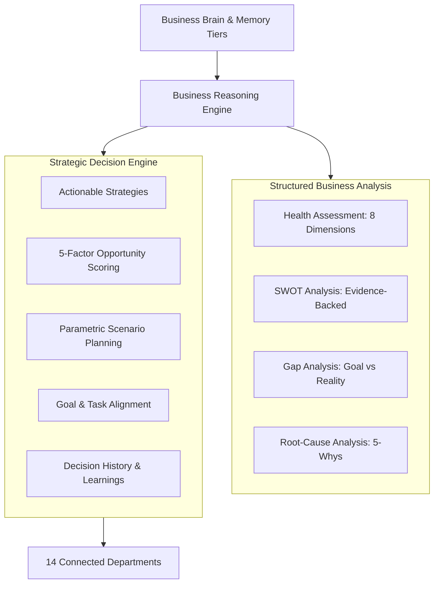
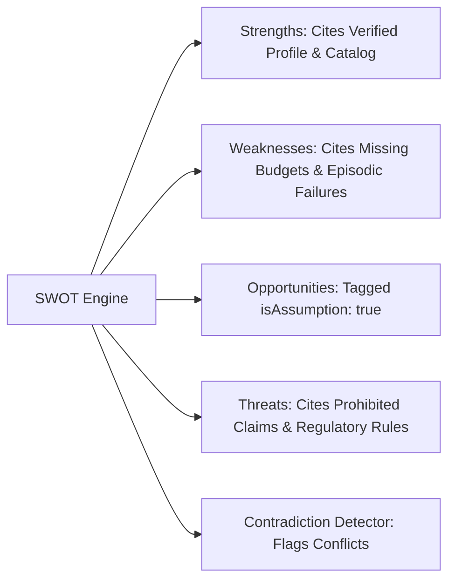

# BRAINWISE BUSINESS BRAIN — PHASE 3
## Deliverable 3.1: Business Reasoning Engine Architecture

---

### 1. Executive Summary & Architectural Mission

In Phase 1 and Phase 2, the BrainWise Business Brain established an authoritative knowledge foundation, a multi-hop knowledge graph, and a four-tier memory infrastructure. However, enterprise SaaS founders do not need mere information retrieval or generic LLM advice.

**Phase 3: Business Reasoning and Decision Intelligence Engine** introduces the strategic reasoning layer that analyzes verified business conditions, identifies hidden vulnerabilities, distinguishes correlation from causation, and produces measurable, constraint-bounded next steps.

---

### 2. Dimensioned Business Health Assessment

The Health Assessment Engine ([`businessAnalysisService.ts`](file:///d:/brainwise%20pro/brainwise%20(1)/src/server/services/businessAnalysisService.ts)) evaluates the enterprise across **eight distinct operational dimensions**, calculating scores ($0-100$), status classifications (`critical`, `needs_improvement`, `moderate`, `strong`), and maturity tiers (`nascent`, `developing`, `scaling`, `established`):

| # | Dimension | Evaluated Criteria | Scoring Logic |
| :---: | :--- | :--- | :--- |
| **1** | **Positioning** | Presence of explicit value proposition, tagline, and brand positioning statement. | Defined Value Prop + Positioning = $95$; Value Prop only = $75$; Missing = $25$. |
| **2** | **Product Portfolio** | Catalog SKU depth, verified pricing, pricing structures, feature-benefit sets. | $\ge 3$ verified products = $90$; $1-2$ products = $65$; Empty catalog = $20$ (Critical). |
| **3** | **Customer Segments** | Documented ICP personas, pain points, wholesale vs retail audience clarity. | $\ge 2$ Personas = $85$; $1$ Persona = $60$; Unconfigured = $25$ (Critical). |
| **4** | **Marketing Maturity** | Brand identity guidelines locked, voice descriptors, approved & restricted claims. | Voice + Approved Claims = $80$; Unconfigured guidelines = $30$. |
| **5** | **Market Presence** | Defined industry sector, geographical hub, competitive landscape awareness. | Industry + Location specified = $70$; Unclassified = $35$. |
| **6** | **Growth Readiness** | Active, tracked business goals aligned to departments with measurable targets. | Active goals in flight = $80$; No tracked OKRs = $40$. |
| **7** | **Operational Limitations** | Verified monthly marketing budget ceiling, weekly production capacity limits. | Budget + Throughput verified = $90$; Either verified = $65$; Neither = $30$. |
| **8** | **Data Completeness** | Fact provenance ratio: `USER_CONFIRMED` facts vs missing or unverified fields. | Calculated as: $\frac{\text{Confirmed Facts}}{\text{Total Tracked Fields}} \times 100$. |

---

### 3. Evidence-Backed SWOT Analysis

Traditional AI SWOT generators invent speculative claims without provenance. BrainWise enforces strict **evidence citation and assumption labeling**:

#### 3.1 Verification Rules by Category
1. **Strengths:** Must link directly to `USER_CONFIRMED` entities (e.g. verified product catalog, certified claims). Confidence score $\ge 0.90$.
2. **Weaknesses:** Derived from operational voids (e.g. unstated marketing budget) or historical experiment failures recorded in Episodic Memory.
3. **Opportunities:** Where forward-looking market initiatives are identified, they are explicitly stamped with `isAssumption: true` and confidence $\le 0.80$, preventing founders from mistaking speculative opportunities for verified facts.
4. **Threats:** Bound by active regulatory exclusions and brand rules (e.g. `"Never claim organic without official estate certification"`).

#### 3.2 Automated Contradiction Detection
The engine scans active business profiles and product catalogs against brand guidelines:
- If `wordsToAvoid` contains a forbidden term (e.g. `"Instant"`), but a product title or description includes that word, the engine flags a high-priority contradiction:
  > *"Contradiction: Product 'Instant Cold Nitro Pods' contains prohibited brand word 'Instant'."*
- Contradictions are surfaced in the UI before marketing generation can commence.

---

### 4. Business Gap Analysis

The Gap Analysis Engine compares current operational realities against stated business goals (`goalRepository`):
- **Capability Gaps:** Goal targets commercial sales expansion, but catalog has zero active SKUs.
- **Revenue Gaps:** Goal targets aggressive quarterly revenue growth, but marketing budget is undefined (`UNKNOWN`).
- **Operational Constraint Gaps:** Goal targets 50 cafe accounts, but weekly throughput ceiling is unstated, risking over-commitment and delivery failures.
- **Remediation Plan:** Every identified gap provides an immediate, step-by-step remediation recommendation.

---

### 5. Root-Cause Analysis (5-Whys vs Marketing Reflex)

A chronic flaw of generic AI tools is recommending "spend more on advertising" whenever performance falters. BrainWise implements a deterministic **Root-Cause Investigation Engine**:

#### 5.1 Correlation vs Demonstrated Causation
When a performance drop is reported (e.g., *"Customer churn on cold brew keg reorders"*):
1. **Hypothesis Evaluation:**
   - Evaluates unit economics and wholesale minimum commitment friction.
   - Evaluates channel-to-persona mismatch.
   - Evaluates packaging defect rates and logistics return friction from Episodic Memory.
2. **Episodic Memory Grounding:**
   - If past decision records indicate packaging leakage damaged customer retention, the engine attributes root cause to **logistics friction** rather than marketing deficiency.
3. **Investigation Action Plan:**
   - Proposes targeted customer surveys, packaging audits, and lower trial order commitments before authorizing incremental ad spend.
