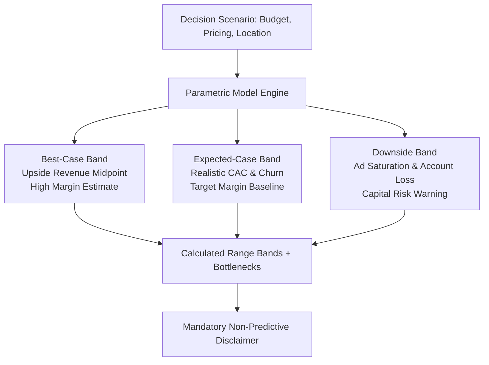

# BRAINWISE BUSINESS BRAIN — PHASE 3
## Deliverable 3.3: Parametric Scenario Planning & Sensitivity Model

---

### 1. Executive Mission & Philosophical Distinction

Entrepreneurs must make consequential resource commitments under uncertainty. Traditional AI systems either generate single-point predictions (inducing false certainty) or give vague generalities.

The **BrainWise Scenario Planning Engine** ([`scenarioPlanningService.ts`](file:///d:/brainwise%20pro/brainwise%20(1)/src/server/services/scenarioPlanningService.ts)) implements a **Parametric Sensitivity Modeling Framework**. It evaluates *what-if* decisions across three distinct outcome bands:
1. **Best-Case:** High customer adoption, zero churn, and unconstrained throughput.
2. **Expected-Case:** Realistic operational friction, moderate CAC inflation, and standard churn.
3. **Downside:** Channel saturation, competitive discounting, and margin compression.



---

### 2. Supported Decision Scenario Archetypes

| Scenario Type | Core Parameter Shift | Evaluated Trade-Off | Key Risk Flagged |
| :--- | :--- | :--- | :--- |
| **`budget_increase_20`** | Marketing spend $+20\%$ | Incremental customer acquisition vs ad channel diminishing returns. | Dispatch and fulfillment throughput ceilings. |
| **`pricing_change`** | Unit price shifted by $\pm \Delta\%$ | Gross margin expansion vs price elasticity and client drop-off. | Commercial accounts defecting to regional competitors. |
| **`cac_increase`** | Blended CAC surges $+30\%$ | Unit payback period resilience under auction bid competition. | Capital exhaustion if spend is maintained unchanged. |
| **`repeat_customer_focus`** | $50\%$ acquisition budget moved to retention | LTV expansion and recurring reorders vs top-of-funnel stagnation. | Keg inventory return turnaround cycles. |
| **`new_location_expansion`** | Launch delivery into adjacent territory | Territory revenue upside vs fixed logistics and cold-chain capex. | Route density delays and vehicle maintenance costs. |
| **`custom`** | User-defined parameters | Parametric sensitivity on bespoke founder assumptions. | Boundary validation. |

---

### 3. Scenario Band Data Model & Heuristics

Every simulation produces three structured bands (`ScenarioBand`):

```typescript
export interface ScenarioBand {
  caseType: 'best_case' | 'expected_case' | 'downside';
  projectedRevenueRange: {
    min: number;                                // Lower boundary of revenue band
    max: number;                                // Upper boundary of revenue band
    midpoint: number;                           // Expected midpoint anchor
  };
  projectedCustomerGrowth: {
    min: number;                                // Lower bound of net account addition
    max: number;                                // Upper bound of net account addition
  };
  estimatedCost: number;                        // Required capital outlay
  netMarginEstimatePercent: number;             // Expected net margin percentage
  keyAssumptions: string[];                     // Explicit prerequisites for this band
  operationalBottlenecks: string[];             // Constraining resources (vehicles, staff, etc.)
}
```

---

### 4. Exemplary Walkthrough: Product Price Adjustment (+10%)

When simulating a $+10\%$ price adjustment on a commercial cold brew keg (e.g. from \$155 to \$170):

#### 4.1 Best-Case Projection
- **Projected Revenue Range:** \$28,750 – \$40,250 (Midpoint: \$34,500)
- **Net Customer Growth:** $+4$ to $+8$ new accounts
- **Estimated Net Margin:** $55\%$
- **Key Assumptions:** Strong brand differentiation absorbs price shift; commercial clients perceive premium positioning.
- **Operational Bottleneck:** Maintaining zero defect rate under premium expectations.

#### 4.2 Expected-Case Projection
- **Projected Revenue Range:** \$21,000 – \$29,400 (Midpoint: \$25,200)
- **Net Customer Growth:** $+2$ to $+5$ accounts
- **Estimated Net Margin:** $48\%$
- **Key Assumptions:** $5\%$ account churn offset by higher gross margin across remaining accounts.
- **Operational Bottleneck:** Account manager time negotiating renewed annual contracts.

#### 4.3 Downside Projection
- **Projected Revenue Range:** \$13,500 – \$18,000 (Midpoint: \$15,750)
- **Net Customer Growth:** $-3$ to $0$ accounts (Net Churn)
- **Estimated Net Margin:** $28\%$
- **Key Assumptions:** Severe price sensitivity drives $20\%$ of accounts to regional discount roasters.
- **Operational Bottleneck:** Underutilized brewing capacity leading to fixed cost drag.

---

### 5. Mandatory Safeguard: Calculated vs Predictive Non-Guarantee

To eliminate liability and protect founders from over-optimism, the engine enforces a strict legal boundary:
> *"Scenario planning outputs represent calculated parametric sensitivity models under explicit assumptions. They are planning tools and do NOT constitute financial forecasts, earnings guarantees, or predictive commitments."*
