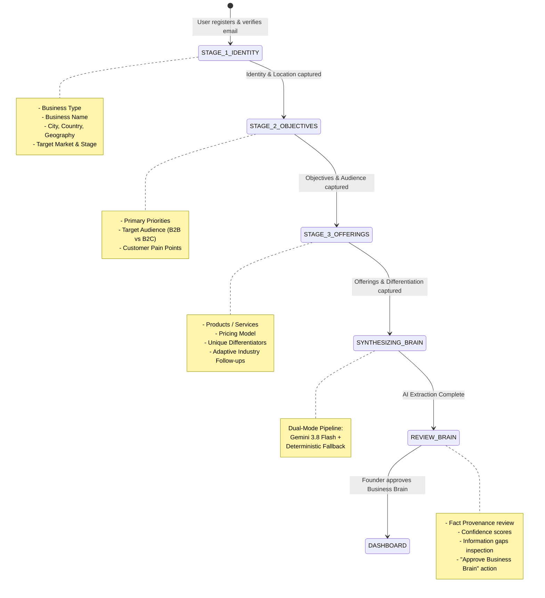

# Phase 5: Technical Architecture Report
## Subsystem Design, Data Flow, State Machines & Knowledge Orchestration

**Document Version:** 1.0.0  
**Phase Status:** COMPLETE & VERIFIED  
**Date:** November 20, 2026  
**System Boundary:** Multi-Tenant SaaS Engine, Authentication, Onboarding & Business Brain

---

## 1. System Topology & Architecture Overview

BrainWise Phase 5 implements a layered, decoupled SaaS architecture where the React 19 client communicates exclusively with the Express REST API via typed contracts. State persistence is isolated in Google Cloud Firestore collections and subcollections.

```mermaid
flowchart TD
    subgraph Client ["Client Layer (React 19 Frozen Design)"]
        UI_AUTH[AuthPages.tsx\nLogin / Register / Verify / Reset]
        UI_ONBOARD[OnboardingPage.tsx\n3-Stage Conversational Flow]
        UI_BRAIN[BusinessBrainPage.tsx\nLiving Profile & Versions]
        STATE_CTX[BrainWiseContext.tsx\nAuth & Session State]
        API_CLIENT[BrainWiseApiClient.ts\nTyped REST Client]
    end

    subgraph API ["API & Routing Layer (Express / TypeScript)"]
        AUTH_ROUTER[authRoutes.ts\n/api/v1/auth & /api/v1/users]
        ONBOARD_ROUTER[onboardingRoutes.ts\n/api/v1/onboarding]
        BRAIN_ROUTER[businessProfileRoutes.ts\n/api/v1/workspaces/:id/business-profile]
        MW_AUTH[auth.ts Middleware\nToken Verification & Hydration]
        MW_WS[workspace.ts Middleware\nMulti-Tenant Access Gate]
    end

    subgraph Services ["Domain Service Layer"]
        AUTH_SVC[authService.ts\nUser & Account Lifecycle]
        ONBOARD_SVC[onboardingService.ts\nState Machine & Autosave]
        BRAIN_SVC[businessBrainService.ts\nProvenance, Approval, Versions]
        AI_SVC[aiOrchestrationService.ts\nDual-Mode Gemini / Fallback]
    end

    subgraph Repositories ["Repository & Persistence Layer"]
        REPO_USER[userRepository.ts\nusers collection]
        REPO_ONBOARD[onboardingRepository.ts\nonboarding_sessions collection]
        REPO_WS[workspaceRepository.ts\nworkspaces collection]
        REPO_BRAIN[businessProfileRepository.ts\nbusiness_profile documents]
        REPO_VER[businessBrainVersionRepository.ts\nbusiness_brain_versions subcollection]
        REPO_AUDIT[auditLogRepository.ts\naudit_logs subcollection]
    end

    subgraph Persistence ["Persistence Layer (Firestore)"]
        DB_USERS[(users)]
        DB_SESSIONS[(onboarding_sessions)]
        DB_WS[(workspaces/{id})]
        DB_PROFILES[(workspaces/{id}/business_profile)]
        DB_VERSIONS[(workspaces/{id}/business_brain_versions)]
    end

    UI_AUTH --> API_CLIENT
    UI_ONBOARD --> API_CLIENT
    UI_BRAIN --> API_CLIENT
    API_CLIENT --> AUTH_ROUTER
    API_CLIENT --> ONBOARD_ROUTER
    API_CLIENT --> BRAIN_ROUTER

    AUTH_ROUTER --> MW_AUTH --> AUTH_SVC --> REPO_USER --> DB_USERS
    ONBOARD_ROUTER --> MW_AUTH --> ONBOARD_SVC --> REPO_ONBOARD --> DB_SESSIONS
    BRAIN_ROUTER --> MW_AUTH --> MW_WS --> BRAIN_SVC

    ONBOARD_SVC --> BRAIN_SVC
    BRAIN_SVC --> AI_SVC
    BRAIN_SVC --> REPO_BRAIN --> DB_PROFILES
    BRAIN_SVC --> REPO_VER --> DB_VERSIONS
    AUTH_SVC --> REPO_WS --> DB_WS
```

---

## 2. Authentication Architecture

### 2.1 Cryptographic Password Security
- **Algorithm:** Node.js native `crypto.scrypt` with random 16-byte salt (`crypto.randomBytes(16)`).
- **Format:** `salt:derivedKey` in hex encoding.
- **Verification:** Target password hashed with extracted salt and compared against stored key using constant-time `crypto.timingSafeEqual`.
- **Entropy & Policy:** Minimum 8 characters, requiring at least one uppercase letter, one lowercase letter, one number, and one special symbol.

### 2.2 Email Verification & 6-Digit Codes
- **Registration Code:** A 6-digit numeric verification code (e.g. `482910`) generated via `crypto.randomInt(100000, 1000000)` and assigned an expiration window (24 hours).
- **Verification Flow:**
  - `POST /api/v1/auth/verify-email`: Validates code against `user.verificationToken` and checks `verificationTokenExpiresAt > now()`.
  - Sets `emailVerified = true`, clears token, and updates `onboardingStatus = 'IN_PROGRESS'`.
- **Resend Flow:**
  - `POST /api/v1/auth/resend-verification`: Generates a fresh 6-digit code and refreshes expiration. Rate-limited to prevent abuse.

### 2.3 Session Management
- **Token Mechanism:** Cryptographic session tokens (`bw-token-<uid>-<timestamp>-<randomHex>` or dev/test bearer tokens) issued on login/verification.
- **Client Storage:** Persisted in `sessionStorage` (`brainwise_auth_token`), never in insecure persistent localStorage.
- **Hydration:** On page load, `BrainWiseContext` inspects `sessionStorage`, validates token with `GET /api/v1/users/me`, and loads user profile.

---

## 3. Conversational Onboarding State Machine

The onboarding journey eliminates traditional multi-page forms, replacing them with a focused 3-stage conversational interface.



### 3.1 Adaptive Question Branching by Business Type
- **Consumer Brand:** Asks for retail/e-commerce distribution channels, packaging differentiation, and direct-to-consumer margins.
- **Technology Startup:** Asks for cloud infrastructure/tech stack advantages, recurring software pricing tiers, and platform scalability.
- **Service Business:** Asks for delivery models (retainer vs project-based), turnaround speed, and high-touch advisory capabilities.
- **Local Business:** Asks for physical foot traffic radius, local community presence, and hyper-local service guarantees.

### 3.2 Incremental Autosave Protocol
- Every answer change debounces and triggers `POST /api/v1/onboarding/save-answer`.
- Payload records `stage`, `step`, and incremental dictionary of `answer`.
- Stored in `onboarding_sessions/{userId}` with `updatedAt` timestamps.
- If the founder closes their browser and logs back in on a different machine, `GET /api/v1/onboarding/session` returns the exact progress, automatically pre-filling answers.

---

## 4. Business Brain Pipeline & Fact Provenance

The Business Brain serves as the single source of truth for all BrainWise departments (Growth, Brand Studio, Competitive Intelligence, Analytics).

### 4.1 Dual-Pipeline Extraction
1. **Primary Pipeline (Google GenAI):** Sends structured prompt to `gemini-3.8-flash` requesting strict JSON matching the `BusinessProfile` schema.
2. **Deterministic Fallback Pipeline:** When API keys are unconfigured, offline, or experiencing timeout/network latency, the fallback engine parses the raw onboarding answers and deterministically generates structured personas, value propositions, and gap analysis.

### 4.2 Fact Provenance Tracking
Every attribute in the Business Brain includes metadata denoting its provenance:
```typescript
interface FactProvenance {
  source: 'USER_CONFIRMED' | 'AI_INFERRED' | 'WORKSPACE_DEFAULT';
  confidence: number; // 0.0 to 1.0
  updatedAt: string;
}
```
- **Authoritative Facts (`USER_CONFIRMED`):** Business Name, Category, Physical Location, Confirmed Pricing, Explicit Differentiators. Confidence: `1.0`.
- **Interpretive Insights (`AI_INFERRED`):** Brand Positioning, Customer Persona Buying Triggers, Willingness to Pay, Information Gaps. Confidence: `0.8 - 0.95`.
- **Preservation Invariant:** When `POST /api/v1/workspaces/:id/business-profile/regenerate` is triggered, all `USER_CONFIRMED` fields are locked and carried forward verbatim. AI interpretation only updates unconfirmed or inferred sections.

### 4.3 Version History & Non-Destructive Rollback
- Every approval, generation, and manual edit writes a snapshot to `workspaces/{workspaceId}/business_brain_versions/{versionId}`.
- History includes `versionNumber`, `snapshot`, `changeDescription`, and `createdBy`.
- Founders can view prior versions via `GET /versions` and restore any historical baseline via `POST /versions/:versionId/restore`.
