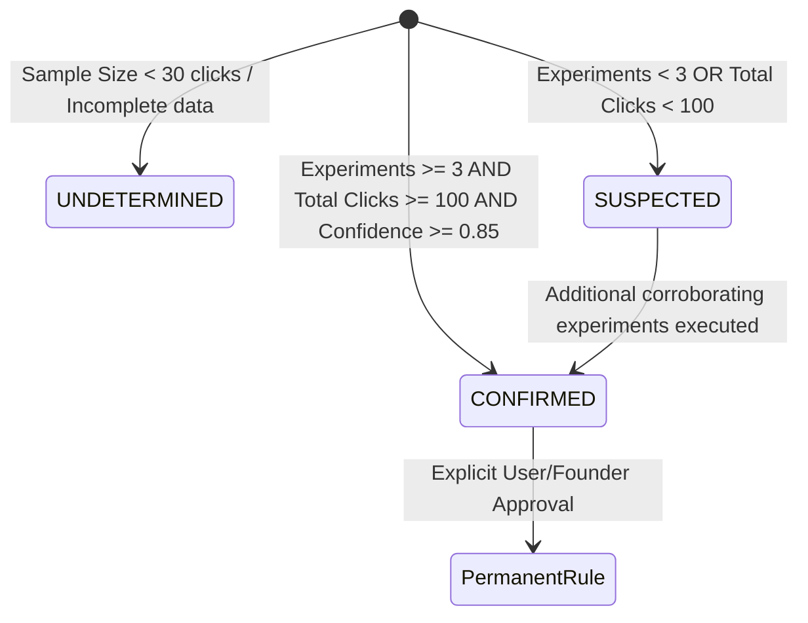

# BrainWise Business Brain — Phase 5: Learning Engine & Pattern Analysis

## 1. Executive Summary

The Learning Engine (`learningEngineService.ts`) synthesizes longitudinal patterns from real-world campaign telemetry, customer personas, objections, and market signals. Its core objective is to distill actionable operational intelligence without succumbing to spurious correlations or promoting weak signals into permanent business policy.

---

## 2. Pattern Insight Taxonomy

The Learning Engine categorizes insights into 8 standard dimensions:

1. `SUCCESSFUL_CAMPAIGN_PATTERN`: Consistently performing channels, creative concepts, or product angles that generate profitable conversions.
2. `UNDERPERFORMING_STRATEGY`: Channels, styles, or offers exhibiting chronic saturation, high CPA, or low ROAS.
3. `EFFECTIVE_SEGMENT`: Customer demographics or personas showing superior resonance with specific value propositions.
4. `STRONG_PRODUCT_CATEGORY`: Catalog offerings with natural organic pull and superior gross margins.
5. `COMMUNICATION_STYLE`: Tone, format, or messaging structures that maximize engagement without price resistance.
6. `CHANNEL_PERFORMANCE`: Channel-level health assessment (CAC trend, volume ceiling, saturation point).
7. `SEASONAL_OPPORTUNITY`: Predictable cyclical surges in consumer demand.
8. `RECURRING_OBJECTION`: Common friction points raised during sales dialogues or customer support interactions.

---

## 3. Evidence Rigor & Permanent Rule Guardrail

### 3.1 The Guardrail Principle
> **Strict Guardrail:** A weak correlation, single experiment outcome, or small-sample trend must **NEVER** be promoted into an immutable business rule or permanent exclusion.

### 3.2 Confidence Bands and Thresholds
The engine assigns one of three confidence bands to every synthesized pattern:



| Confidence Band | Statistical Requirement | Promoted to Permanent Rule? | System Action |
| :--- | :--- | :--- | :--- |
| **`UNDETERMINED`** | Insufficient observations ($N < 30$) | **No** | Highlighted as hypothesis requiring testing |
| **`SUSPECTED`** | $1 - 2$ experiments, or $N < 100$, confidence $< 0.85$ | **No (`isPermanentRule: false`)** | Surfaced as cautionary observation; does not constrain AI generation |
| **`CONFIRMED`** | $\ge 3$ consistent experiments, $N \ge 100$, confidence $\ge 0.85$ | **Requires Founder Consent** | Informs department strategy prompts; eligible for permanent memory |

---

## 4. Pattern Synthesis Algorithms

### 4.1 Channel Performance Synthesis
```typescript
// Channels are aggregated across all historical experiments
for (const [channel, stats] of channelMap.entries()) {
  const expCount = stats.experiments.length;
  
  if (stats.successes >= 1 && stats.successes >= stats.failures) {
    const isStrong = expCount >= 3 && stats.totalClicks >= 100;
    patterns.push({
      category: 'SUCCESSFUL_CAMPAIGN_PATTERN',
      title: `High Conversion Channel: ${channel}`,
      confidence: isStrong ? 0.90 : expCount >= 2 ? 0.75 : 0.60,
      confidenceBand: isStrong ? 'CONFIRMED' : 'SUSPECTED',
      isPermanentRule: isStrong,
      actionableRecommendation: `Allocate greater share of monthly growth budget to '${channel}' campaigns.`
    });
  }
}
```

### 4.2 Customer Objection Distillation
The engine crawls verified `customerPersonas` in the Business Brain, grouping reported sales objections:
- Identifies common themes across disparate segments.
- Automatically generates actionable objection-handling FAQs for Sales and Brand Studio vector collateral.

---

## 5. Episodic Memory Integration

Whenever a campaign concludes, an episodic memory record (`EpisodicMemoryEntity`) is generated with:
- `activityType`: `'experiment_success' | 'experiment_failure' | 'campaign_run'`
- `learnings`: Empirical takeaways derived from statistical performance.
- `outcomes`: Exact CPA, ROAS, conversion count, and cost breakdown.

Subsequent department generations retrieve these episodes, ensuring future campaigns build incrementally upon past learnings rather than repeating fatigued or unprofitable approaches.
