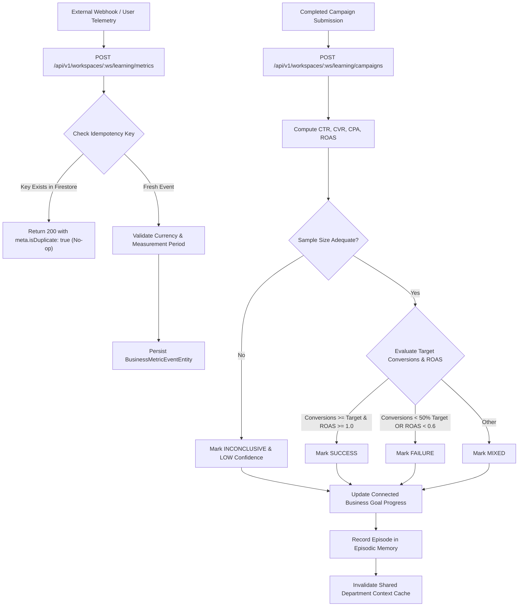

# BrainWise Business Brain — Phase 5: Continuous Learning & Performance Ingestion Architecture

## 1. Executive Summary

The Performance Ingestion Architecture provides BrainWise with an autonomous, mathematically rigorous telemetry pipeline. Prior to Phase 5, the Business Brain operated primarily in a consultative, instruction-waiting mode. With the continuous performance ingestion infrastructure, BrainWise ingests granular marketing telemetry, e-commerce transactions, and campaign experiments across all 14 departments, continuously grounding strategic models in real-world commercial outcomes.

### Architectural Directives & Product Boundaries
- **Strict Video Exclusion:** In full alignment with BrainWise Master Product Rules, performance telemetry strictly concerns vector collateral (SVG banners, flyers, stationery), deterministic copywriting variants, multi-frame static carousels, and print campaigns. Zero video generation, video editing, or video credit metrics are permitted.
- **Vanity vs. Commercial Metric Separation:** Views, clicks, and impressions are strictly classified as top-of-funnel diagnostic metrics and are never conflated with bottom-of-funnel commercial performance (leads, acquisitions, customer conversions, revenue, GMV).
- **Idempotency & Deduplication:** All metric ingestion events support deterministic cryptographic or webhook idempotency keys (`idempotencyKey`) preventing double-counting of conversions or financial figures during network retries.

---

## 2. Ingestion Models & Schemas

### 2.1 Business Metric Event Schema (`BusinessMetricEventEntity`)
Every ingested metric event adheres to the following specification:

| Field | Type | Description |
| :--- | :--- | :--- |
| `metricId` | `string` | Unique identifier (`metric_{timestamp}_{randomHex}`) |
| `workspaceId` | `string` | Tenant isolation key |
| `source` | `string` | Telemetry origin (e.g., `Shopify Webhook`, `Google Analytics 4`, `Stripe`) |
| `metricType` | `enum` | `VIEW`, `CLICK`, `ENGAGEMENT`, `LEAD`, `CONVERSION`, `RETENTION`, `REVENUE`, `SPEND` |
| `metricName` | `string` | Human-readable descriptor (e.g., `Store Checkout GMV`, `Reel View Count`) |
| `value` | `number` | Numeric quantitative value |
| `currency` | `string?` | ISO 4217 currency code (required for `REVENUE` and `SPEND`) |
| `definition` | `string` | Exact definition of how metric was computed |
| `channel` | `string?` | Marketing channel (`Instagram`, `LinkedIn`, `Email`, `Search`, etc.) |
| `campaignId` | `string?` | Optional linkage to specific campaign |
| `attributionModel`| `enum` | `FIRST_TOUCH`, `LAST_TOUCH`, `LINEAR`, `DATA_DRIVEN`, `UNATTRIBUTED` |
| `isAttributed` | `boolean` | True if commercial value is explicitly tied to an origin touchpoint |
| `sampleSize` | `number?` | Number of observations behind metric |
| `measurementPeriod`| `object` | `{ startDate: string, endDate: string }` |
| `timestamp` | `string` | ISO 8601 recording timestamp |
| `idempotencyKey` | `string?` | Deduplication key |
| `confidence` | `number` | Data confidence score ($0.0 - 1.0$) |

### 2.2 Campaign Experiment Result Schema (`CampaignExperimentResultEntity`)
Completed marketing experiments capture both empirical metrics and derived statistical health ratios:

| Field | Type | Rationale & Calculation |
| :--- | :--- | :--- |
| `experimentId` | `string` | Unique experiment identifier |
| `campaignName` | `string` | Title of campaign initiative |
| `objective` | `string` | Business objective stated prior to execution |
| `hypothesis` | `string` | Testable hypothesis |
| `channel` | `string` | Channel tested |
| `budget` vs `cost` | `number` | Planned allocation vs. actual cash expended |
| `conversionMetrics`| `object` | **CTR:** $\frac{\text{clicks}}{\text{views}} \times 100$ **CVR:** $\frac{\text{conversions}}{\text{clicks}} \times 100$ **CPA:** $\frac{\text{cost}}{\text{conversions}}$ **ROAS:** $\frac{\text{revenue}}{\text{cost}}$ |
| `sampleSizeAdequate`| `boolean` | Requires $\ge 30\text{ clicks}$ and $(\ge 5\text{ conversions} \lor \ge 500\text{ views})$ |
| `attributionConfidence`| `enum` | `'HIGH'`, `'MEDIUM'`, `'LOW'`, `'UNKNOWN'` |
| `outcome` | `enum` | `'SUCCESS'`, `'MIXED'`, `'FAILURE'`, `'INCONCLUSIVE'` |
| `lessonsLearned` | `string[]` | Grounded post-mortem takeaways automatically synthesized |

---

## 3. Mathematical Evaluation & Statistical Guardrails

### 3.1 Derived Ratio Formulations
1. **Click-Through Rate (CTR):**
   $$\text{CTR} = \begin{cases} \left(\frac{\text{Clicks}}{\text{Views}}\right) \times 100, & \text{if Views} > 0 \\ \text{undefined}, & \text{otherwise} \end{cases}$$

2. **Conversion Rate (CVR):**
   $$\text{CVR} = \begin{cases} \left(\frac{\text{Conversions}}{\text{Clicks}}\right) \times 100, & \text{if Clicks} > 0 \\ \text{undefined}, & \text{otherwise} \end{cases}$$

3. **Cost Per Acquisition (CPA):**
   $$\text{CPA} = \begin{cases} \frac{\text{Cost}}{\text{Conversions}}, & \text{if Conversions} > 0 \\ \text{undefined}, & \text{otherwise} \end{cases}$$

4. **Return on Ad Spend (ROAS):**
   $$\text{ROAS} = \begin{cases} \frac{\text{Revenue}}{\text{Cost}}, & \text{if Cost} > 0 \land \text{Revenue} > 0 \\ \text{undefined}, & \text{otherwise} \end{cases}$$

### 3.2 Statistical Significance & Missing Data Handling
To prevent premature or hallucinatory conclusions based on negligible traffic, BrainWise enforces:
- If $\text{Clicks} < 30$ or $(\text{Conversions} < 5 \land \text{Views} < 500)$, `sampleSizeAdequate` is marked `false`.
- When sample size is inadequate, `attributionConfidence` is downgraded to `'LOW'`, and the outcome is classified as `'INCONCLUSIVE'`.
- Missing metrics (e.g., zero impressions recorded) strictly produce `undefined` ratios rather than false zeros.

---

## 4. End-to-End Ingestion Flow

---

## 5. Multi-Tenant Isolation & Storage Implementation

All ingested telemetry is persisted under workspace-isolated Firestore paths:
- `workspaces/{workspaceId}/businessMetrics/{metricId}`
- `workspaces/{workspaceId}/campaignPerformance/{experimentId}`

Queries always require authenticated membership in `{workspaceId}`. Cross-tenant leakage is strictly blocked by `requireWorkspaceMember` middleware and tenant-keyed database references.
