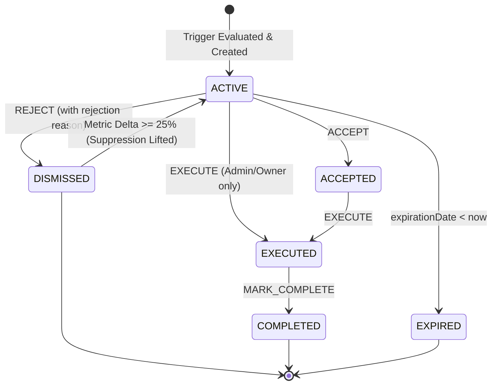

# BrainWise Business Brain — Phase 5: Recommendation Lifecycle & Dismissal Suppression

## 1. Executive Summary

BrainWise empowers users to manage proactive recommendations through a deterministic 7-action lifecycle state machine (`recommendationLifecycleService.ts`). The lifecycle couples granular action tracking with an authoritative **Dismissal Suppression Guardrail**, guaranteeing that user-dismissed insights are never nagged back to the operator unless underlying business metrics change materially ($\ge 25\%$).

---

## 2. The 7 Recommendation Lifecycle Actions

| Action | Transition State | Description & Effect | Role Requirement |
| :--- | :--- | :--- | :--- |
| **`ACCEPT`** | `'ACCEPTED'` | Founder approves recommended strategic action; routes to execution queue. | Member, Admin, Owner |
| **`REJECT`** | `'DISMISSED'` | User rejects recommendation; records rejection reason and activates suppression. | Member, Admin, Owner |
| **`EDIT`** | `'ACTIVE'` | User modifies parameters, budget, or target audience before acting. | Member, Admin, Owner |
| **`DEFER`** | `'ACTIVE'` | Postpones recommendation until a specified future date (`deferredUntil`). | Member, Admin, Owner |
| **`ASSIGN`** | `'ACTIVE'` | Designates a specific team member (`assignedTo`) to oversee evaluation. | Admin, Owner |
| **`EXECUTE`** | `'EXECUTED'` | Launches corresponding department action (e.g., Brand Studio vector drafting). | **Admin, Owner Only** |
| **`MARK_COMPLETE`** | `'COMPLETED'` | Marks the recommendation as fulfilled after real-world completion. | Member, Admin, Owner |

---

## 3. Recommendation Lifecycle State Machine



---

## 4. The 25% Metric Delta Suppression Guardrail

### 4.1 Problem Statement
In traditional AI assistants, dismissing a recommendation often results in the exact same recommendation reappearing minutes or days later, causing operator frustration and alert blindness.

### 4.2 Mathematical Suppression Rule
When a user rejects an insight:
1. The system saves `dismissalMetadata` containing:
   - `dismissedAt`: Timestamp of rejection.
   - `dismissedBy`: User ID of actor.
   - `reason`: Captured qualitative reason for auditability.
   - `metricValueAtDismissal`: The quantitative baseline metric at that exact moment.
2. During all subsequent trigger scans:
   $$\text{Delta} = \left|\frac{\text{CurrentMetric} - \text{MetricAtDismissal}}{\text{MetricAtDismissal}}\right|$$
3. If $\text{Delta} < 0.25$ ($25\%$), the insight is **strictly suppressed** and will not be regenerated.
4. Only if the business condition shifts materially ($\text{Delta} \ge 25\%$) does the system lift suppression to re-alert the user.

```typescript
// Repository suppression check implementation
public async isSuppressed(
  workspaceId: string,
  triggerType: ProactiveTriggerType,
  title: string,
  currentMetricValue?: number
): Promise<boolean> {
  const dismissed = await this.listDismissed(workspaceId, triggerType);
  const match = dismissed.find((d) => d.title === title);
  if (!match) return false;

  const baseline = match.dismissalMetadata?.metricValueAtDismissal;
  if (baseline !== undefined && currentMetricValue !== undefined && baseline > 0) {
    const delta = Math.abs(currentMetricValue - baseline) / baseline;
    if (delta >= 0.25) {
      return false; // Material 25% change: re-surface alert
    }
  }

  return true; // Still within 25% threshold: suppress
}
```

---

## 5. Role-Based Access Control (RBAC) on Consequential Actions

Consequential actions (such as `EXECUTE` involving real marketing budget or launching live campaigns) mandate elevated authorization:
- Regular `member` roles cannot trigger irreversible executions.
- Attempts by unauthorized roles return `403 AUTHORIZATION_ERROR`.
- Every transition is immutably logged with actor attribution for enterprise governance.
